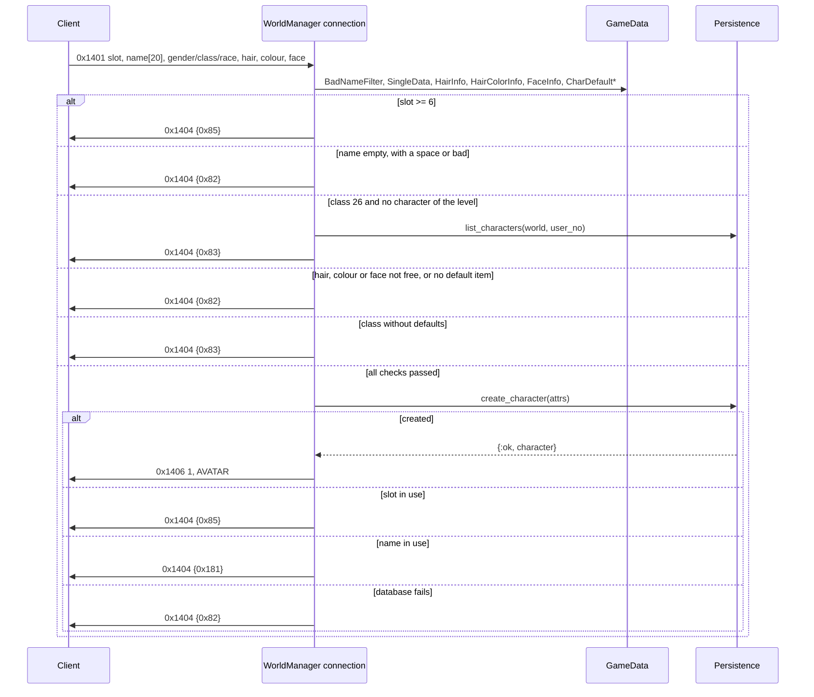

# Flow: character create

From `0x1401` at WorldManager to `0x1406` or `0x1404` (`WorldManager.Handler`, `WorldManager.CharacterCreate`, `GameData`, `Persistence.create_character/1`, `WorldManager.Avatar.created/1`). The request is accepted only after the login of the connection (`0x0C0F`); before that it closes the socket like any first packet other than `0x0C0F`.

The connection stays open after every answer.

## Checks, in the order of the original (W01 section 4.1, D02 section 3.3)

| Check | Code | Client text |
|---|---|---|
| `slot >= 6` | `0x85` | "error in the Max Slot Number" |
| name empty, longer than 20 bytes, with a space (`0x20`), or bad | `0x82` | "Failed to create the character." |
| class 26 and the highest level on the account and world is below `SingleData` `ChrLevel_CanCreateSen` (60) | `0x83` | wrong class |
| hair, hair colour or face missing in `HairInfo` / `HairColorInfo` / `FaceInfo`, or its `Grade` is not 0 | `0x82` | "Failed to create the character." |
| no `CHARACTER` default row for the class | `0x83` | wrong class (the original answers `0x181`; our assumption: the accurate code) |
| a default item missing in `ItemInfo`, or the first weapon without slot 10 or 12 | `0x82` | "Failed to create the character." |
| slot in use (checked before the name) | `0x85` | "error in the Max Slot Number" |
| name in use in the world, any letter case | `0x181` | "The name is already in use." (captured, `37b` index 16) |
| any database failure | `0x82` | "Failed to create the character." |

## Name rules

A name has 1 to 20 bytes (W01-B4 kept: the original takes 20 bytes, the client field is 20 bytes without terminator, so a 20-byte name is sent unterminated in `0x1406` and `0x0C14`). A name is raw bytes, not UTF-8. `BadNameFilter.shn` has a `BadName` and a `Type`. `Type 0`: the name equals the bad name without regard to ASCII case. `Type 1`: the bad name, as written in the file, is a substring of the upper-cased name. A `Type 1` row with a lower-case letter therefore never matches, as in the original. Case folding is ASCII only (the original uses the multi-byte functions of an unknown code page). The name must be unique per world, compared with `Persistence.Character.name_key/1` (ASCII lower-case).

## What is stored

| Stored | From |
|---|---|
| level, exp, login map, login position, HP, SP, HP stones, SP stones, money | `DefaultCharacterData` `CHARACTER` row of the class |
| race | the class (`g_ClassRace`: class 0 gives 0, 1 to 10 and 21 to 25 give 1, 11 to 15 and 26 to 27 give 2, 16 to 20 give 3); the race bits of the request are ignored |
| gender, class, hair, hair colour, face | the request |
| tutorial state | 2 for class 26, else 0 |
| items | `ITEM` rows in file order: the first with `ItemInfo.Class` 5 is equipped (storage 8, slot `ItemInfo.Equip`, 10 or 12), the others go to storage 9 with slots 0, 1, 2, ... ; `Lot` from the row |
| skills, shortcuts | `SKILL` and `SHORTCUT` rows of the class (the last row of a slot wins) |
| `kq_date` | the creation time; no Kingdom Quest map, position 0 |

Not stored: quests (no row in the 2016 data), item keys and attributes, the character options and key map.

## AVATAR of 0x1406

Built like the list record ([`character-list.md`](character-list.md)) with two differences: `loginmap` is the stored map (the list sends "RouT" while the tutorial state is 0, P02-B33), and `change_id_init` is 0 (the list sends `0x64`). `delinfo` is zero, `kq_map_name` empty, `kq_handle` `0xFFFFFFFF`, equipment `0xFFFF` except an equipped weapon.

## Original-server bugs

- W01-B2 (a wrong `0x84` for slot, name and class): fixed, `0x85`, `0x82`, `0x83`.
- D02-B1 (`0x182` / `0x183` / `0x184`, which the client has no text for): fixed, `0x85` and `0x82`.
- D02-B2 (a failed statement leaves the transaction open): fixed, a refusal leaves the transaction.
- W01-B4 (a 20-byte name without terminator): kept.
- P02-B7 (two uninitialised bits in the date byte of the AVATAR): fixed, 0; masked in the replay.
- P02-B24 is an effect of the link between WorldManager and the Character server, which does not exist here.

## Differences from the original

- The character server and the game log are not involved; the checks of both run in one process.
- The highest level for class 26 is read from the database, not from a copy of the avatar list of the session.
- `0x1402`, `0x1403`, `0x1405` and `0x140D` (server links) are not sent.
