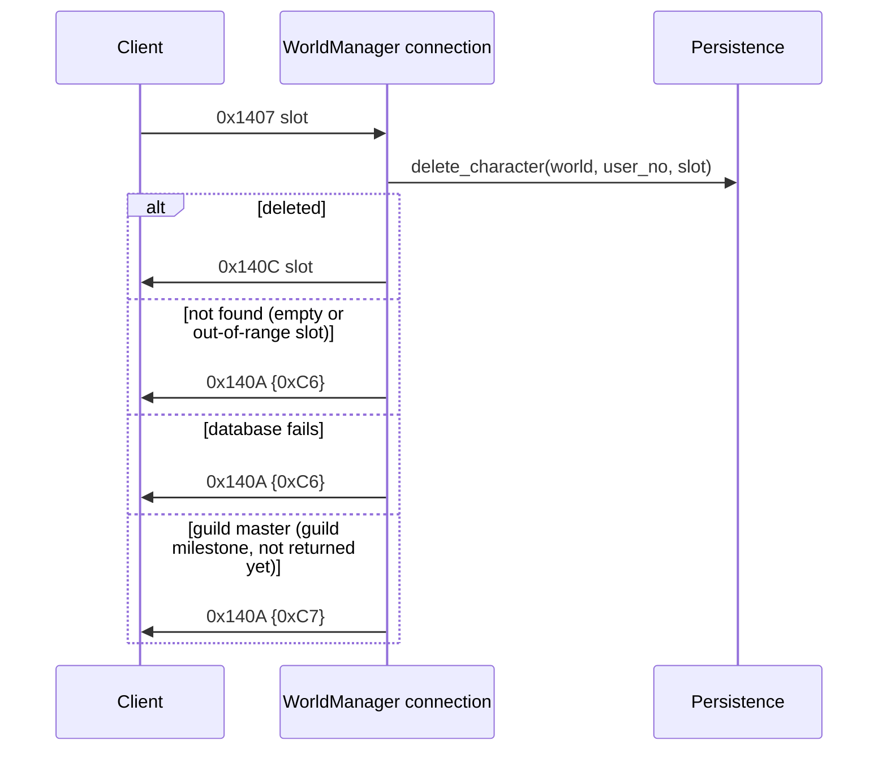

# Flow: character delete

From `0x1407` at WorldManager to `0x140C` or `0x140A` (`WorldManager.Handler`, `Persistence.delete_character/3`). The request is accepted only after the login of the connection (`0x0C0F`); before that it closes the socket like any first packet other than `0x0C0F`.

The connection stays open after every answer.

## Codes

| Code | Client text (`FUN_00476860`) |
|---|---|
| `0xC7` | "You may not delete guild leader." |
| every other code, so also `0xC6` | "Unable to delete a Guild Master character." |

No code gives a neutral text with the unmodified client.

## What is deleted

The `characters` row and, by cascade, its `items`, `character_skills` and `character_shortcuts`. The row is gone for good; slot and name are free at once (captured: `37` creates "X37Del" again 27 s later). Character numbers are not reused.

## Original-server bugs

- D02-B4 fixed: the delete is one transaction.
- W01-B3 and D02-B3 kept: `0xC6` with the guild-master text, because the client has one text for every code but `0xC7` and no neutral code exists.

## Differences from the original

No Character server. The guild check (`0x1413` / `0x1414`) and the links `0x1408`, `0x140B`, `0x140E`, `0x0412`, `0xC805`, `0x9424`, `0x10B2`, `0x9425` are not sent. The slot is looked up in the database, not in the session's avatar copy. Friends, guild membership and zone notification come with their milestones.
