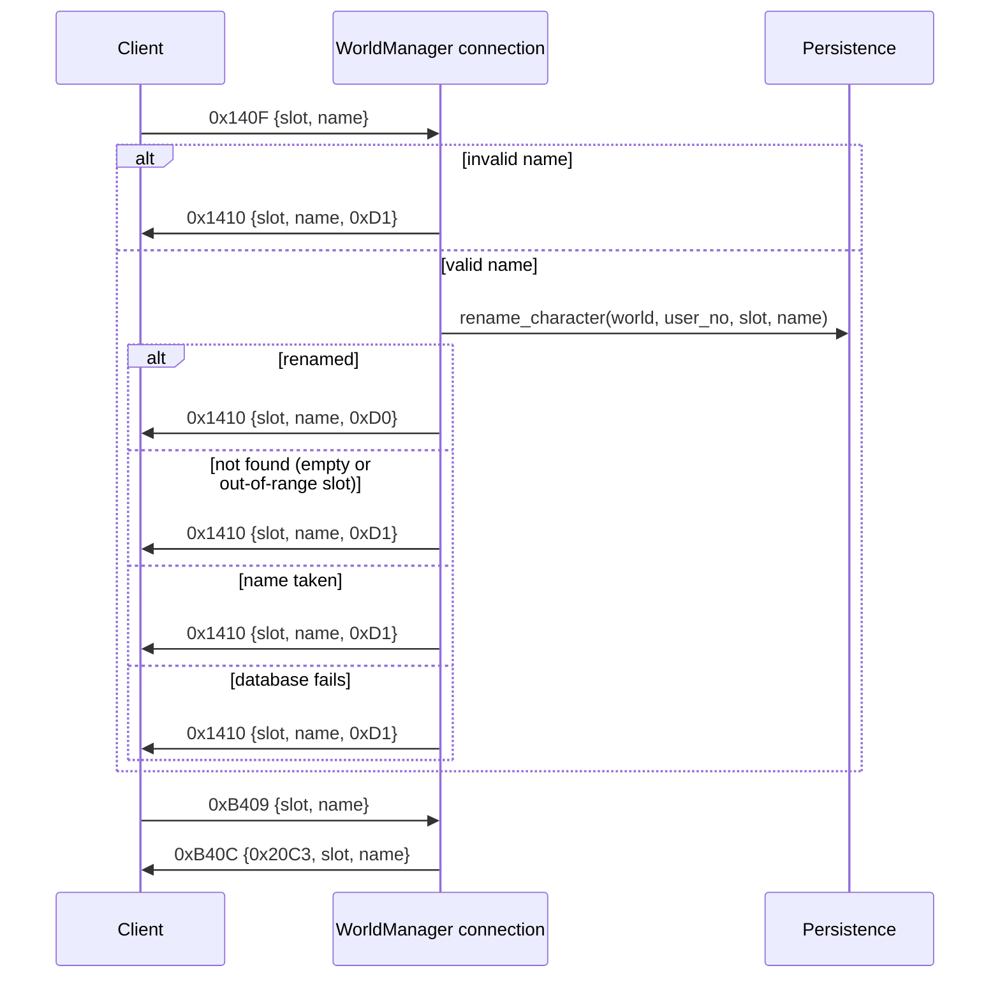

# Flow: character rename

From `0x140F` at WorldManager to `0x1410` (`WorldManager.Handler`, `WorldManager.CharacterCreate.valid_name?/2`, `Persistence.rename_character/4`). The request is accepted only after the login of the connection (`0x0C0F`); before that it closes the socket like any first packet other than `0x0C0F`.

`0xB409` calls no `Persistence` operation. The connection stays open after every answer.

## Codes

| Code | Client text |
|---|---|
| `0xD0` | none; the character list shows the new name |
| `0xD1` | "The name cannot be used." (`FUN_00476c70`) |
| `0x20C3` (`0xB40C`) | no rename right; what the client shows is open until the manual check with the real client (issue 98) |

## Name rules

1 to 16 bytes, no space, not in `BadNameFilter.shn`. The name is unique per world, ASCII letter case ignored; renaming to the own name in another case works. The old name is free at once.

## Original-server bugs

- P02-B42 fixed: a taken name is refused with `0xD1`; the original answered `0xD0` and two characters shared the name (captured in `37b` and scenario 52).
- P02-B34 fixed: `0xB40C` carries the slot of the request; the original sent a stack byte for every code but `0x20C0`.

## Differences from the original

No Character server (`0x1411` / `0x1412`, `0xB40A` / `0xB40B`, `0xB40F` are not sent). The slot is looked up in the database. `0xB409` does none of the original's checks (`0x20C1`, `0x20C2`, `0x20D3`) and grants nothing until the item milestone.

## Not checked

How the client decides to open the rename window. The captures show it on selecting a character whose name contains `-`.
