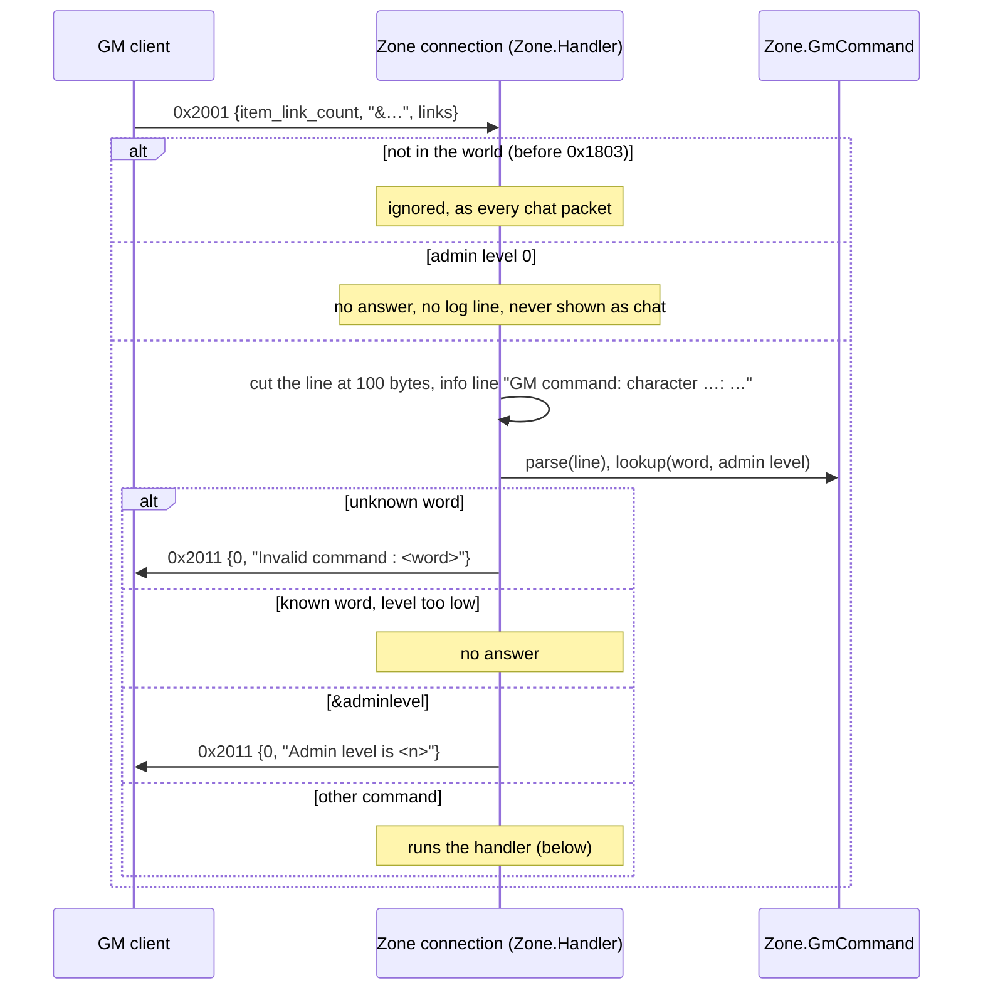
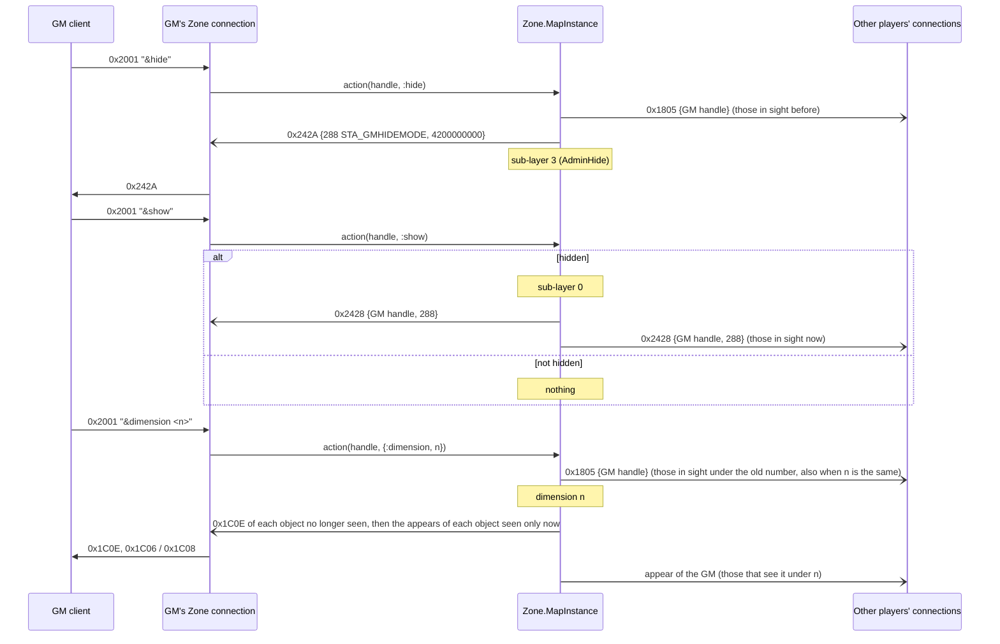
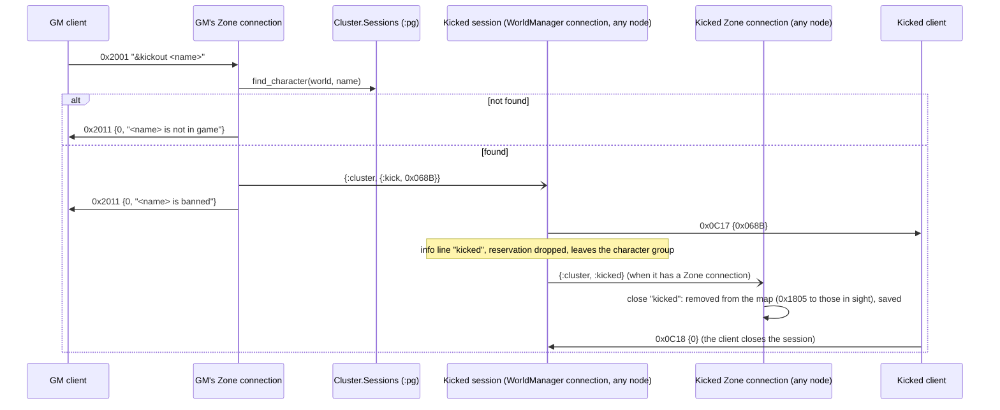

# Flow: GM commands

A `0x2001` chat line that starts with `&` is a GM command (`Zone.Handler`, `Zone.GmCommand`). The Zone connection
parses it, looks the word up in the one command table and runs the handler; the commands reach the map instance
(`&hide`, `&show`, `&dimension`), the map change (`&linkto`) or the WorldManager session of another character
(`&kickout`). Source: `docs/pseudocode/zone/Z11-gm-commands.md` §1 and §3.1 (`so_ply_AdminCommand` @ FUN_00427a40,
`ListIter_AmpCmdArgument` @ FUN_00427550). User documentation: [`gm-commands.md`](../../user/gm-commands.md).

## The frame



### Checks, in order

1. The connection is in the world (step `:in_world`); before `0x1803` a chat packet is ignored.
2. The line starts with `&`: then none of the chat rules (item-link limit, spam filter, shout) applies.
3. Admin level 0: silence (no answer, no log line).
4. The line is cut at 100 bytes and logged at `info` with `inspect/1` of the name and the line (control bytes of the
   client stay escaped). Z11-B1 fixed: the original logs nothing of a GM with a level above 100.
5. `Zone.GmCommand.parse/1`: tokens split on spaces outside `"` quotes, `\` escapes the next byte, empty tokens
   dropped; the word cut at 20 bytes, at most 12 arguments, each cut at 32 bytes (Z11-B2 fixed: the original copies
   an argument of any length into its 32-byte buffer).
6. `Zone.GmCommand.lookup/2`: exact, case-sensitive word; the level of the table (`&adminlevel` 1, `&hide`, `&show`,
   `&linkto`, `&kickout` 10, `&dimension` 100) against the character's admin level.

A number argument is read as `sscanf("%d")` (`Zone.GmCommand.number/1`): no digits is 0, clamped to the signed
32-bit range.

The admin level is the column `characters.admin_level`, loaded with the character at the first map login
(`Persistence.load_character/3`, `Zone.Player.new/4`) and kept in the player struct across map changes. The task
`Persistence.Release.set_admin_level/3` writes only the database.

## `&hide`, `&show`, `&dimension` through the map instance



The actions run like the other actions (`docs/technical/flows/actions.md`): a player in mode 0 is ignored, the
mover is stepped first. After `&show` nothing announces the GM: the other client asks with `0x1C01` when it sees a
move of an object it does not know (`Zone.Sight`, [`../sight.md`](../sight.md)). `&dimension` runs one exchange
(`Zone.Sight.dimension/3`, [`../sight.md`](../sight.md), "Dimension change"), computed from the GM's sight under the
old number and under the new one: `0x1805 {GM handle}` to the players that saw the GM under the old number; to the
GM the `0x1C0E` of every object it no longer sees, then the appear packets of every object it sees only now; the
GM's appear to every player that sees it under the new number. Players count in mode 1 within the full radius,
NPCs are every NPC of the map. The same number again sends `0x1805` and then the GM's appear to the players that
see it, and nothing to the GM. No abstate is stored: the hide icon
is not sent again after a map change or a relog. `Zone.MapInstance.relocate/3` (a `0x1809`) and every entry into a
map instance reset the dimension and the sub-layer to 0 without a packet.

P02-B27 (fixed by decision, issue 90): the original sends an appear and a delete of each object near a GM in another
dimension for every step; the rebuild applies the sight rules once: the dimension exchange runs once per command,
nothing runs per step.

## `&linkto` into the map change

```mermaid
sequenceDiagram
    participant C as GM client
    participant Z as Zone connection
    participant M as Zone.MapInstance
    participant L as Zone.Link
    C->>Z: 0x2001 "&linkto [<map> [<x> <y>]]"
    alt no argument
        Z->>M: free_spot()
        M-->>Z: {x, y} on the own map, or :error (info line, nobody moves)
    else "-"
        Z->>C: 0x2011 {0, "Invalid map name"}
    else <map>
        Note over Z: MapInfo row of the map, else "Invalid map name"
        Note over Z: (x, y) = the two numbers, else RegenX / RegenY; negative: info line, nobody moves
    end
    Z->>L: run(map, player, entered_at, session, dest)
    alt same map instance
        L-->>Z: {:same, …}
        Z->>C: 0x1809 {map index, x, y}
    else other map instance or node
        L-->>Z: {:other, …} or {:moved, …}
        Z->>C: 0x180A or 0x1809 (see map-change.md)
    else map not running (or no MapInfo row)
        Z->>C: 0x2011 {0, "Invalid map name"}
    end
```

`&linkto` takes the path of the gates and the town portal ([`map-change.md`](map-change.md)) with the origin `:gm`:
no answer packet of its own; the refusals other than "not running" and "no `MapInfo` row" log their usual line. The free spot is a random
point of the map whose cell is free, by rejection sampling of at most 100 draws through `Random.uniform/1`
(shortcut: not the quadtree of `bd_FindEmptyCoord` FUN_00438960, Z09 §9.4). Like every arrival, the target point is placed by the map instance: the GM
lands on the nearest free cell of the point, or on the map's start point (`RegenX` / `RegenY`) when there is none in
reach, and `0x1809` carries the placed point; with no free cell around either the change is refused with the
`warning` line `Zone: map change refused: no free cell on <map> around (<x>, <y>)` and no answer.

## `&kickout` across Zone connection, session and Zone connection



The lookup is by character name, ASCII letter case ignored (the whisper lookup), so it reaches a session on any
WorldManager node and a player between two maps: then the open reservation is dropped and the later `0x1801` of that
player is refused with `0x1804 {0x141}`. The GM's connection does not wait for the kick, so its notice can come
before the `0x1805` of the kicked player (the capture of scenario 52 has the `0x1805` first). The notices name the
character as the GM typed it. P02-B41 fixed: the original sends `" is banned"` without the name. Z11-B6 fixed: the
original found only players of the GM's own zone and answered "<garbled name> is not in game" for the others; here
"is not in game" means the name is not in the world, and it carries the name. A second `&kickout` of the same name
answers "is not in game": the session left the character group.

## Packets

| Opcode | Direction | Fields |
|---|---|---|
| `0x2001` NC_ACT_CHAT_REQ | client → Zone | `item_link_count: u8`, `content` (u8 length), `links` |
| `0x2011` NC_ACT_NOTICE_CMD | Zone → client | `unused: u8` (sent as 0; Z09-B54 kept: the original leaves it unwritten), `text` (u8 length) |
| `0x242A` NC_BAT_ABSTATEINFORM_NOEFFECT_CMD | Zone → GM | `abstate: u32` (288), `keep_time: u32` (ms, 4 200 000 000) |
| `0x2428` NC_BAT_ABSTATERESET_CMD | Zone → GM and players in sight | `handle: u16`, `abstate: u32` (288) |
| `0x1805` NC_MAP_LOGOUT_CMD | Zone → players in sight | `handle: u16` |
| `0x0C17` NC_USER_CONNECTCUT_CMD | WorldManager → kicked client | `error: u16` (`0x068B`) |

## Not built

`AdminLvSet.shn` is not loaded: it changes only the levels of `&scrint`, `&templink` and `&oxblock`; it is loaded
when the first of those is built (issue 93). The mini-house refusals of the original, `&linkto -` to the normal
location (it answers "Invalid map name"), every other command word, the GM chat colour bit, the GM chat ban and the
original's separate `AmpersandCommandLog` file.
