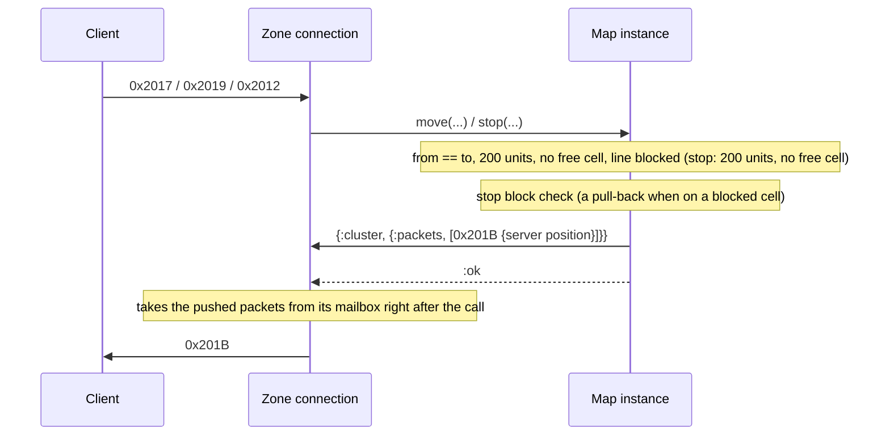
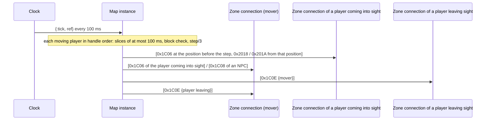
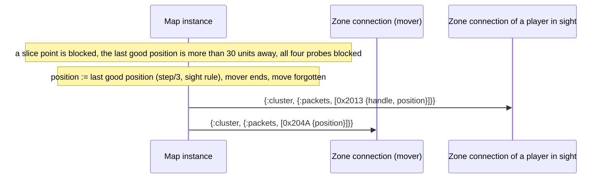

# Flow: movement

Walk, run and stop between a Zone connection, its map instance and the players in sight (`Zone.Handler`,
`Zone.MapInstance`, `Zone.Mover`, `Zone.Sight`). The rules: [`../movement.md`](../movement.md).

## Accepted move

```mermaid
sequenceDiagram
    participant C as Client (mover)
    participant Z as Zone connection (mover)
    participant I as Map instance
    participant O as Zone connection of a player in sight
    participant OC as Its client
    C->>Z: 0x2017 walk / 0x2019 run {from, to}
    Note over Z: in the world only; before it, no answer
    Z->>I: move(handle, kind, from, to)
    Note over I: step the mover to the millisecond, then the checks
    Note over I: new mover from the server position, remember the move packet
    I->>O: {:cluster, {:packets, [0x2018 / 0x201A {handle, from = server position, to, speed, 0}]}}
    O->>OC: 0x2018 / 0x201A
    I-->>Z: :ok
    Note over Z: nothing for the mover itself
```

## Refusal



## Stop

```mermaid
sequenceDiagram
    participant C as Client
    participant Z as Zone connection
    participant I as Map instance
    participant O as Zone connection of a player in sight
    C->>Z: 0x2012 {loc}
    Z->>I: stop(handle, loc)
    Note over I: step the mover to the millisecond; loc within 200 units with a free cell
    Note over I: mover ends, the remembered move is forgotten
    I->>O: {:cluster, {:packets, [0x2013 {handle, server position}]}}
    I-->>Z: :ok
```

## Tick step with appear and disappear



## Pull-back


