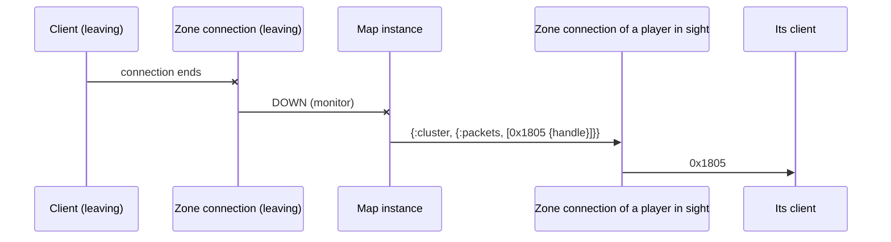

# Flow: sight

The entry exchange, `0x1C01` and the leave packet `0x1805` between Zone connections and their map instance
(`Zone.Handler`, `Zone.MapInstance`, `Zone.Sight`, `Zone.Grid`). The rules: [`../sight.md`](../sight.md).

## Entry exchange

```mermaid
sequenceDiagram
    participant C as Client (entrant)
    participant Z as Zone connection (entrant)
    participant I as Map instance
    participant O as Zone connection of a player in sight
    participant OC as Its client
    C->>Z: 0x1803
    Z->>I: login_complete(handle)
    Note over I: mode 1, crowd radius, walk of the NPCs and the players in sight
    I->>O: {:cluster, {:packets, [0x1C06 of the entrant]}}
    O->>OC: 0x1C06 (only in the world; dropped before)
    I-->>Z: the second burst with the 0x1C09 / 0x1C07 batches after 0x583A
    Z->>C: 0x10E4 … 0x583A, 0x1C09 (28), 0x1C07, 0x1C09 (rest), 0x105B … 0x245F
```

## `0x1C01`

```mermaid
sequenceDiagram
    participant C as Client
    participant Z as Zone connection
    participant I as Map instance
    C->>Z: 0x1C01 {my_handle, receive_net_command, handle}
    Note over Z: in the world only; my_handle is ignored
    Z->>I: inform(own handle, handle)
    alt in sight and shown to the requester
        I-->>Z: [0x1C06] for a player, [0x1C08] for an NPC
        Z->>C: the appear packet
    else unknown, the requester itself, out of sight, hidden
        I-->>Z: []
        Note over Z: no answer, no log line
    end
```

## Leave


