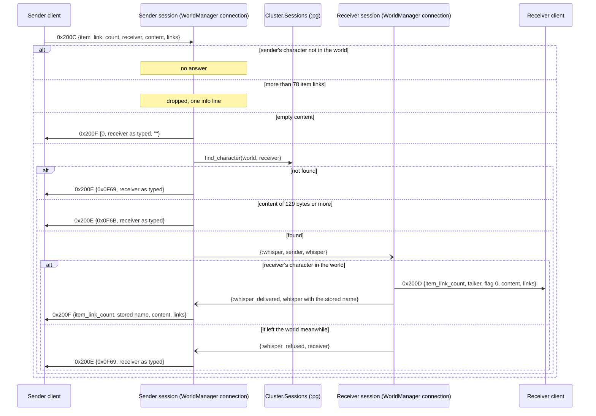

# Flow: whisper

A line to one character of the world by name (`WorldManager.Handler`, `Cluster.Sessions`). WorldManager alone handles
it; the Zone takes no part. Both sessions can be on any WorldManager node of the world.

## Checks, in order

1. The sender's character is in the world; otherwise the packet gets no answer and the connection stays open (the
   unmodified client cannot whisper from character select).
2. At most 78 item links: above that the relayed `0x200D` could exceed the frame limit. More are dropped with the
   line `WorldManager: whisper dropped: <n> item links`.
3. Empty content: the echo `0x200F` at once, with count 0 and no links, before any lookup.
4. Receiver lookup: `Cluster.Sessions.find_character/2`, ASCII letter case ignored, any node of the world.
5. Content length: 129 bytes or more is refused with `0x0F6B`.

A packet whose size is not exactly `22 + len + item_link_count × 0x67` payload bytes is dropped by its size check in
`Net.Connection` (one `debug` line `dropped a packet of the wrong size`) before the handler sees it.

## Packets

| Opcode | Direction | Fields |
|---|---|---|
| `0x200C` NC_ACT_WHISPER_REQ | client → WorldManager | `item_link_count: u8`, `receiver: char[20]`, `content` (u8 length), `links` (`item_link_count × 0x67` opaque bytes) |
| `0x200D` NC_ACT_SOMEONEWHISPER_CMD | WorldManager → receiver | `item_link_count: u8`, `talker: char[20]`, `flag: u8` (always 0), `content`, `links` |
| `0x200E` NC_ACT_WHISPERFAIL_ACK | WorldManager → sender | `error: u16`, `receiver: char[20]` |
| `0x200F` NC_ACT_WHISPERSUCCESS_ACK | WorldManager → sender | `item_link_count: u8`, `receiver: char[20]` (the stored spelling), `content`, `links` |

| Code | Meaning | Client text |
|---|---|---|
| `0x0F69` | receiver not found (unknown name, or a character at character select) | "Cannot find the recipient." |
| `0x0F6B` | content of 129 bytes or more | none (W04-B5 kept) |

## In the world

A session's character is in the world from the redeem of its map-login ticket (`0x1801` at a Zone,
`Cluster.Sessions.enter_world/2`) until the session accepts a new `0x1001` (`leave_world/2`) or its process ends. A
closed Zone connection does not end it: that is a character between maps.

Item links are relayed as opaque bytes; only their number and size are checked. A whisper to yourself needs no special
case: the session sends the message to itself and gets `0x200D`, then `0x200F`.

## Absent until their milestones

Prison (`0x0F6A`), Guild Tournament (`0x0F6C`), the chat ban, the chat-title counter `0x6006` and the GM colour bit
of the `0x200D` flag.

## Original-server bugs

- W04-B2 gone: the size check of the packet; the original copied the item links past its buffer.
- W04-B4 fixed: the count of the empty-whisper echo is 0 (masked in replays).
- W04-B5 kept: `0x0F6B` has no client text.
- P02-B29 fixed: the flag of `0x200D` is 0, the original left bits 1 to 7 stale (masked in replays).
