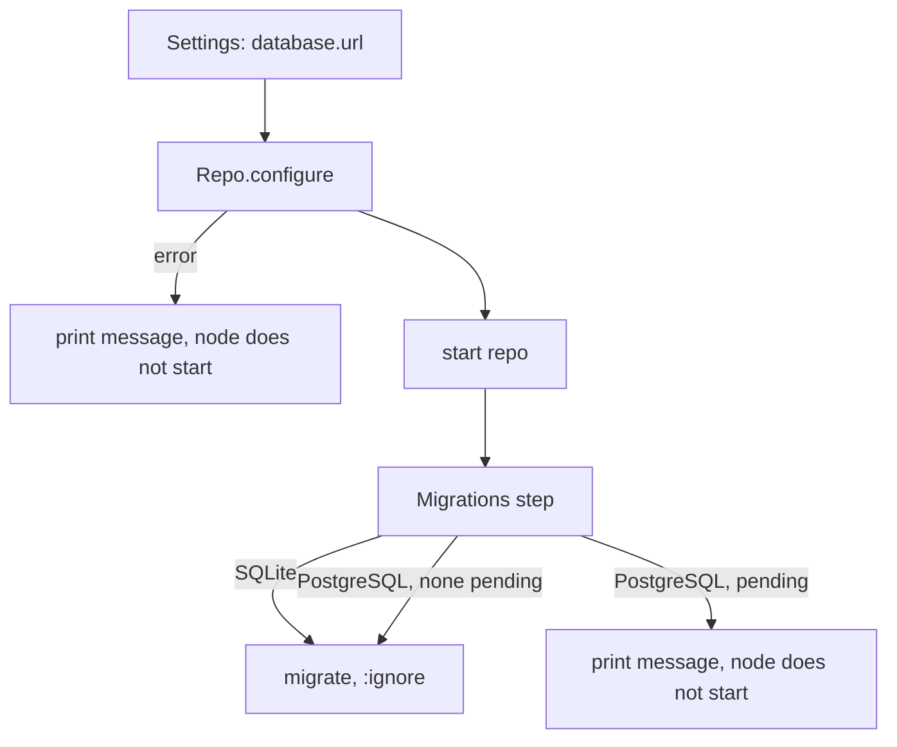

# Persistence

The `Persistence` boundary is the only code that names a repo, a schema or a query ([ADR 0004](../adr/0004-one-database-guarded-updates-no-row-locks.md)). Other parts call its functions and read tagged results.

## Modules

| Module | What |
|---|---|
| `Persistence` | the public operations (`create_account/2`, `check_login/2`, `set_blocked/2`, `set_login_able/2`, `list_characters/2`, `load_character/3`, `create_character/1`, `delete_character/3`, `rename_character/4`, `place_characters/2`, `set_admin_level/3`, `skip_tutorial/3`, `save_character/4`), each one `repo.transact` |
| `Persistence.Supervisor` | starts the repo and the migration step |
| `Persistence.Repo` | private: maps `database.url` to a repo module and its config; `active/0` |
| `Persistence.Repo.Postgres`, `Persistence.Repo.SQLite` | the two Ecto repos |
| `Persistence.Migrations` | private: start-up migration step |
| `Persistence.Account` | private: schema and name rules |
| `Persistence.Character`, `Persistence.Item`, `Persistence.Skill`, `Persistence.Shortcut` | private: schemas of `characters`, `items`, `character_skills` and `character_shortcuts` |
| `Persistence.Password` | private: PBKDF2 hashing |
| `Persistence.Release` | operator commands without Mix; the `mix pinata.*` tasks only call it |

`Persistence.Repo.configure/1` puts the repo config into the application environment, because `Ecto.Migrator.with_repo/3` starts a repo from there, and records the chosen repo as `:persistence_repo`. SQLite runs with `default_transaction_mode: :immediate`, `pool_size: 1` and `queue_target: 5_000`: SQLite has one writer, so further connections would only wait on its lock and fail after the busy timeout, and a queued request is dropped only after about 10 s instead of 100 ms (found by the load run under a busy CPU).

## Start-up

## The accounts table

| Column | Type | Meaning |
|---|---|---|
| `id` | integer, primary key | the user number |
| `name` | string | as given at creation |
| `name_key` | string, unique | `name` without trailing spaces, ASCII letters lower-cased |
| `password_hash` | binary | PBKDF2-HMAC-SHA256, 32 bytes |
| `password_salt` | binary | 16 bytes from `Random.bytes/1` |
| `password_iterations` | integer | iterations used for this hash |
| `blocked` | boolean | the account is banned; default false |
| `login_able` | boolean | the account may enter; default true |

The name key models SQL Server's default comparison, case-insensitive and blind to trailing spaces of the original (*inferred*). A valid name has 1 to 255 bytes in `0x21..0x7E`; `check_login` never fails on odd bytes, such a name is `:unknown`.

## The characters table

| Column | Type | Check |
|---|---|---|
| `id` | integer, primary key | 1 to 4294967295 |
| `world_id` | integer | 0 to 255 |
| `account_id` | references `accounts`, delete cascade | |
| `slot` | integer | 0 to 5 |
| `name` | binary | 1 to 20 bytes (the original accepts any non-space bytes) |
| `name_key` | binary | `name` with ASCII letters lower-cased |
| `level` | integer, default 1 | 1 to 255 |
| `login_map` | string | 1 to 12 characters |
| `race`, `class`, `gender` | integer | 0 to 3, 0 to 31, 0 to 1 |
| `hair`, `hair_color`, `face` | integer | 0 to 255 |
| `kq_map` | string, default `""` | at most 12 characters |
| `kq_x`, `kq_y` | bigint, default 0 | 0 to 4294967295 |
| `kq_date` | utc_datetime | the time of the last save (the character list shows it) |
| `tutorial_state` | integer | 0 to 3 |
| `tutorial_step` | integer, default 0 | 0 to 255 |
| `exp` | bigint, default 0 | at least 0 |
| `login_x`, `login_y` | bigint, default 0 | 0 to 4294967295; the position the character logs in at |
| `hp`, `sp`, `money` | bigint, default 0 | at least 0 |
| `hp_stones`, `sp_stones` | integer, default 0 | at least 0 |
| `play_minutes` | bigint, default 0 | at least 0; whole minutes in the world, added at each leave |
| `logout_at` | utc_datetime, nullable | the last leave; none for a character that never left the world |
| `admin_level` | integer, default 0 | 0 to 255; above 0 the character is a GM ([`flows/gm-commands.md`](flows/gm-commands.md)) |

Unique indexes: `(world_id, account_id, slot)` and `(world_id, name_key)`. `play_minutes` and `logout_at` come from the second migration of the table (`20261122000000_add_character_play_time`), which adds both columns and the check of `play_minutes` the same way. `admin_level` comes from the third
(`20261126000000_add_character_admin_level`), with its check the same way.

Checks work on both adapters through one list per table in the migration: SQLite takes a check only as the `check:` option of a column, PostgreSQL ignores that option and gets a `create constraint` per check when the adapter is PostgreSQL (SQLite cannot add constraints later).

## The items table

| Column | Type | Check |
|---|---|---|
| `character_id` | references `characters`, delete cascade | |
| `storage` | integer | 0 to 255; 8 is the equipment |
| `slot` | integer | 0 to 255; the `ItemEquipEnum` number for storage 8 |
| `item_id` | integer | 0 to 65535 |
| `upgrade` | integer, default 0 | 0 to 255 |
| `lot` | integer, default 1 | at least 1 |

Unique index `(character_id, storage, slot)`. Storage 9 is the inventory; only character creation writes it so far.

## The character_skills and character_shortcuts tables

`character_skills`: `character_id` (references `characters`, delete cascade) and `skill_id` (0 to 65535), unique `(character_id, skill_id)`. `character_shortcuts`: `character_id`, `slot`, `code` (integer) and `value` (bigint), all at least 0, unique `(character_id, slot)`. Both are filled from the defaults at creation.

## Create

`create_character/1` is one transaction of guarded statements: a check that the slot is free (`{:error, :slot_in_use}`), the insert of the character (a unique-index violation on the name is `{:error, :name_taken}`, on the slot `{:error, :slot_in_use}`, so the slot is reported before the name), then one `insert_all` for the items, the skills and the shortcuts, each matched against its row count. Any other failure is `{:error, :database}` with a logged line. A refusal leaves the transaction, so on PostgreSQL the next statement of the connection works (D02-B2 fixed). The name key is `Persistence.Character.name_key/1`; the same name is allowed in another world. `kq_date` is the creation time.

## Rename

`rename_character/4` is one transaction: it reads the character by `(world_id, account_id, slot)` and updates `name` and `name_key` by id. No row is `{:error, :not_found}`; a violation of the unique index on `(world_id, name_key)` is `{:error, :name_taken}` (the name is unique per world, ASCII letter case ignored; P02-B42 fixed); anything else is `{:error, :database}` with a logged line. Flow: [`flows/character-rename.md`](flows/character-rename.md).

`place_characters/2` (the operator command of the load run, [`load-run.md`](load-run.md)) is one transaction: one guarded `update_all` per entry on `characters` by `(world_id, name_key)`, in `name_key` order, setting `login_map`, `login_x` and `login_y`. An entry with no row leaves the transaction with `{:error, {:no_character, name}}` and nothing is changed; a database failure is `{:error, :database}` with a logged line.

`set_admin_level/3` (the operator command `Persistence.Release.set_admin_level/3`) is one transaction with one guarded `update_all` on `characters` by `(world_id, name_key)` setting `admin_level`; no row is `{:error, :unknown}`, a failure `{:error, :database}` with a logged line. A character in the world keeps the level it was loaded with until its next login.

## Map entry

`load_character/3` (the Zone at map entry) is one transaction with two reads: the character by `(world_id, account_id, id)` and its items with storage 8 ordered by slot. It returns the stored values the map-entry burst sends (level, experience, position, HP, SP, money, stones, look, admin level) with the equipment; no row is `{:error, :not_found}`, a failure `{:error, :database}`.

## Save

`save_character/4` (the Zone, flow: [`flows/leave-world.md`](flows/leave-world.md)) is one transaction with one guarded `update_all` on `characters` by `(world_id, id)`. It sets `login_map`, `login_x`, `login_y`, `hp`, `sp` and `kq_date` (now, as the original's `p_Char_SaveLocation` sets `dKQDate`). The kind `:auto` (auto-save) stops there; `{:leave, minutes}` also sets `logout_at` to now and adds `minutes` to `play_minutes` (`inc:`). No other column is touched, so columns a later issue adds keep their values. One affected row is `:ok`, none (the row was deleted) `{:error, :not_found}`, any other failure `{:error, :database}` with a logged line. It runs in the Zone connection process, never in the map instance.

## Tutorial skip

`skip_tutorial/3` is one transaction with one guarded `update_all` on `characters` by `(world_id, account_id, slot)` and `tutorial_state = 0`, setting `tutorial_state` to 2. One affected row is `:ok`, none (an empty slot or another state) is `{:error, :not_found}`, any other failure `{:error, :database}` with a logged line. Flow: [`flows/enter-world.md`](flows/enter-world.md).

## Delete

`delete_character/3` is one transaction with one guarded `delete_all` on `characters` by `(world_id, account_id, slot)`. One affected row is `:ok`, none is `{:error, :not_found}`. The foreign keys of `items`, `character_skills` and `character_shortcuts` cascade, so the character is deleted with everything it owns (D02-B4 fixed: one transaction). `{:error, :guild_master}` is reserved for the guild milestone; nothing returns it yet. Any other failure is `{:error, :database}` with a logged line. Flow: [`flows/character-delete.md`](flows/character-delete.md).

### Not carried over from the original (D02 section 3.1 to 3.2)

- [ ] `bDeleted` / `dDeletedDate`: `delete_character/3` deletes rows for good, so a listed character is never deleted.
- [ ] `nKQHandle`: no Kingdom Quest instance exists; the wire value is constant.
- [ ] `nKQD`, `tCharacterChangeID`: no rename rights.
- [ ] The account-wide tutorial skip of `usp_Tutorial_getIsSkip`.
- [ ] Quests of the defaults (the 2016 data has none; the table comes with the quest milestone), item keys and item attributes (milestone 3), `tCharacterOptions` and the key map.
- [ ] `nAdminLevel`, `nCreateWorld`.

## Passwords

The default is 600,000 iterations; `Application.get_env(:pinata, :password_iterations, 600_000)` lets tests lower it. The compare uses `:crypto.hash_equals/2`. An unknown name still costs one derivation (zero salt) so the time does not tell.

`Persistence` hashes the password bytes it gets. The 2016 client sends 32 lower-case hex characters, the MD5 of the typed password, in `0x0C5A` (`docs/protocol/capture-validation.md` section 16.3), so the account command hashes that form. That the MD5 covers only the typed password is not verified by a capture; the Login part (issue 41) and the capture checkpoint confirm it.

## Login results

`check_login` checks in the original's order (D01 section 3.2): unknown account, wrong password, blocked, not login-able. A database failure gives `{:error, :database}` from `check_login/2` and `create_account/2`, with one `:error` log line that names the operation and the exception and never the account name or the password. The Login part maps unknown and wrong password to client code 0x45, blocked to 0x47, not login-able to 0x48.

Fields of D01 section 3.2 not carried over: `bIsDelete`, `nAuthID` / `tUserAuth` (see the next section), login by e-mail, timed blocks (`tUserBlock`, `usp_User_chkBlock`), the EGPal and merge additions.

## Blocked and login-able

The two flags are two separate outputs of the original account check and reach the 2016 client as two different codes. Source: `docs/pseudocode/db/D01-account.md` section 3.2 and `docs/pseudocode/login-server.md` section 5.1; the table and column names are from the database backups (*db-backup*).

| | `blocked` | `login_able` |
|---|---|---|
| Original source | `tUser.bIsBlock`, one bit per account | `tUserAuth.bIsLoginAble`, one value per group; the account holds the group in `tUser.nAuthID` |
| Field of `0x0C5C` | `nBlock != 0` refuses | `bLoginAble != 1` refuses |
| `check_login` result | `{:error, :blocked}` | `{:error, :not_login_able}` |
| Client code and text | 0x47 "The ID has been blocked." | 0x48 "The World Servers are down for maintenance." |
| Purpose | ban one account | let only some groups in, for example staff during maintenance or testers in a closed beta |

Differences from the original:

- There are no groups here. `login_able` is a column of the account, so closing the server to all players means setting it on each account. A later change may add groups or a server-wide switch ([#57](https://github.com/wbpascal/pinata/issues/57)); the two results of `check_login` stay the same either way.
- A block here has no end date. The original cleared `bIsBlock` when the last timed block in `tUserBlock` had expired.

## Tests

`mix test` runs with `--no-start` (alias in `mix.exs`); `test/test_helper.exs` picks the database (`DATABASE_URL`, else a fresh SQLite file in `tmp/`) and then starts the application. CI runs the suite on both adapters. `:extra_migration_paths` in the application environment adds migration directories; only a test uses it, to create a pending migration.

## Adding an operation or a migration

An operation is a function in `Persistence` with a `@spec` and one `repo.transact` of guarded statements; follow the portability rules in [`AGENTS.md`](../../AGENTS.md). A migration is a new file in `priv/repo/migrations/` with a `change/0`; PostgreSQL nodes refuse to start until `Persistence.Release.migrate()` ran it.
