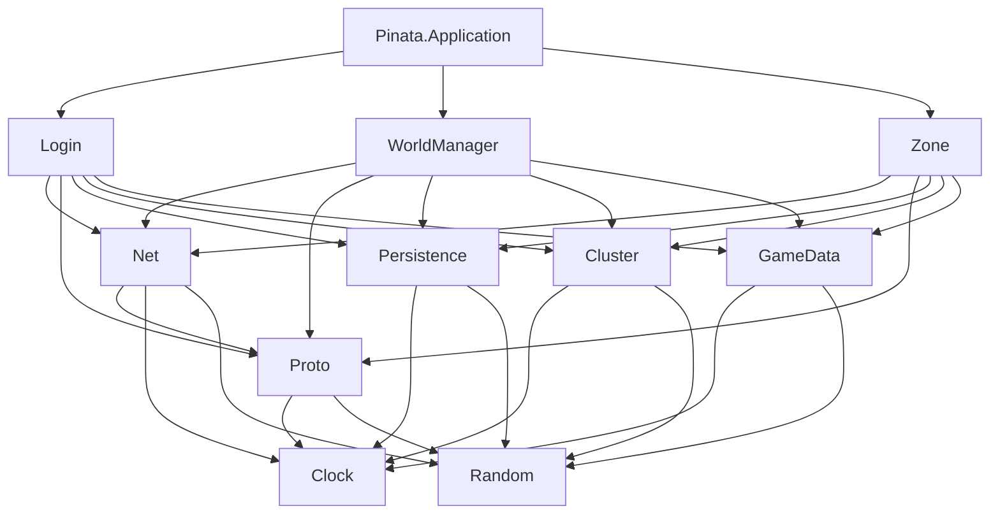
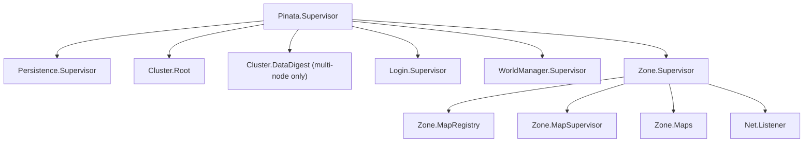

# Technical documentation

How the server is built now. The reasons are in the ADRs (`docs/adr/`), the behaviour of the original server in `docs/protocol/` and `docs/pseudocode/`.

## Parts and boundaries

The server is one Mix project, application `:pinata` ([ADR 0001](../../../docs/adr/0001-single-mix-project-with-checked-boundaries.md)). Each top-level namespace is a boundary, and the `boundary` compiler fails the build on a reference that the table does not allow.

| Boundary | Kind | What | May use |
|---|---|---|---|
| `Login` | part | the Login part | all libraries |
| `WorldManager` | part | the WorldManager part | all libraries |
| `Zone` | part | the Zone part | all libraries |
| `Net` | library | client listener and connection process | `Proto`, `Settings`, `Clock`, `Random` |
| `Proto` | library | framing, cipher, packet definitions | `Clock`, `Random` |
| `Persistence` | library | database access ([`persistence.md`](persistence.md)) | `Settings`, `Clock`, `Random` |
| `Cluster` | library | registry and the facades between parts | `Settings`, `Clock`, `Random` |
| `GameData` | library | client and server data tables, their import | `Clock`, `Random` |
| `Settings` | library | the settings of the node, read once at start-up | nothing |
| `Clock` | library | the only reader of system time | nothing |
| `Random` | library | the only caller of `:rand` | nothing |
| `Pinata.Figures` | library | the capacity figures ([`telemetry.md`](telemetry.md)) | nothing |
| `Pinata.Otel` | library | start of OpenTelemetry and its `:telemetry` handlers ([`telemetry.md`](telemetry.md)) | `Pinata.Figures` |
| `Pinata.Application` | application | starts the supervision tree | the parts, `Persistence`, `Cluster`, `Settings`, `GameData`, `Pinata.Figures`, `Pinata.Otel` |

A part never uses another part. `Proto` and `Net` are built; each part starts a client listener. Login handles the login path and the world select (see [`flows/login.md`](flows/login.md), [`flows/world-select.md`](flows/world-select.md)); WorldManager handles the hand-over login `0x0C0F`, sends the character list ([`flows/character-list.md`](flows/character-list.md)) and handles `0x1401`, the creation of a character ([`flows/character-create.md`](flows/character-create.md)), `0x1407`, the deletion of a character ([`flows/character-delete.md`](flows/character-delete.md)), `0x140F` and `0xB409`, the renaming of a character ([`flows/character-rename.md`](flows/character-rename.md)), `0x0C33` and `0x0C18 {0}` (see [`flows/return-to-world-list.md`](flows/return-to-world-list.md)) and `0x1001` / `0x1111`, the character login; Zone handles the map login `0x1801` with the Client data check (both in [`flows/enter-world.md`](flows/enter-world.md)) and the map entry up to `0x1803` with the WorldManager burst and the login-time requests ([`flows/map-entry.md`](flows/map-entry.md)); the map instances decide who sees whom and send the appear, disappear and leave packets and the answer to `0x1C01` ([`sight.md`](sight.md), [`flows/sight.md`](flows/sight.md)) and move the players that walk, run and stop (`Zone.Mover`, [`movement.md`](movement.md), [`flows/movement.md`](flows/movement.md)); leaving the world, the auto-save and the second login that waits for the save are in [`flows/leave-world.md`](flows/leave-world.md); WorldManager alone handles the whisper `0x200C` ([`flows/whisper.md`](flows/whisper.md)). The map instances relay normal chat `0x2001` and shout `0x201E` with the spam filter ([`flows/chat.md`](flows/chat.md)). `Persistence` has the tables `accounts`, `characters`, `items`, `character_skills` and `character_shortcuts`; the other libraries are almost empty.

ADR 0001 calls the protocol library `Protocol`. Elixir already has a core module of that name, so the module is `Proto`.

The diagram leaves out three sets of arrows that the table has: the parts also use `Clock` and `Random`, the application uses `Persistence`, `Cluster` and `GameData`, and `Net` uses `Settings`. Every part, `Persistence`, `Cluster` and the application also use `Settings`.

## Start-up

`Pinata.Application.start/2` calls `Settings.load(System.get_env())`. On problems it prints them all to standard error and returns `{:error, :invalid_settings}`. Then it calls `GameData.load/3` with the tables of the parts in `PINATA_PARTS` (`game_data/0` of each part); on problems it prints them all and returns `{:error, :invalid_game_data}`. With the Zone part it then calls `Zone.check_maps/1`, which checks the `.shbd` file of every plain field map (exists, valid header); its problems print the same way. Otherwise, in multi-node mode only (not all parts on the node, or `cluster.nodes` not empty; `Settings.single_node?/1`), it computes `GameData.digest/1` of the data directory, logs it and adds `Cluster.DataDigest` (see [`cluster.md`](cluster.md)); single-node mode hashes nothing. The Logger level is set from `log.level` right after the settings are read, and the default handler's formatter is re-applied from `config/config.exs`, because Mix starts Logger before it loads the config. Then `Pinata.Figures.attach/0` creates the counters of the capacity figures and `Pinata.Otel.start/1` starts the OpenTelemetry applications from the `telemetry` settings (see [`telemetry.md`](telemetry.md)). Then `Pinata.Supervisor` (`:one_for_one`) starts `Persistence.Supervisor`, `Cluster.Root`, `Cluster.DataDigest` (multi-node only), then one supervisor per part in `PINATA_PARTS`, each with the settings as its argument. `Persistence.Supervisor` starts the repo chosen by `database.url` and the migration step. Two start failures come from it: an unusable `database.url` (`{:error, :invalid_database_url}`) and, on PostgreSQL, pending migrations (`{:error, :pending_migrations}`); both print their message to standard error. `Cluster.Root` also starts `Cluster.NodeLog` and `Login.Supervisor` also starts `Login.WorldWatch`, both in multi-node mode only. Each part supervisor starts its client listener (which logs its bound address); the WorldManager supervisor first starts one `WorldManager.World` process per world. When the supervision tree is up, `Pinata.Application` logs one line with the parts, the mode and the database adapter. A listener port that is in use stops the start with one line on standard error.

## Release, image and compose

`mix.exs` defines one release, `pinata` (`releases: [pinata: [include_executables_for: [:unix, :windows]]]`, so it holds `bin/pinata` and `bin/pinata.bat`); `MIX_ENV=prod mix release` builds `_build/prod/rel/pinata`. Its `applications:` list puts `opentelemetry_exporter`, `opentelemetry`, `opentelemetry_experimental` and `opentelemetry_telemetry` into the release in mode `:load`: the boot script loads them and `Pinata.Otel` starts them after the settings are read ([`telemetry.md`](telemetry.md)). A release has no `mix`, so the operator commands are plain functions called with `bin/pinata eval`: `Persistence.Release` (migrations, accounts) and `GameData.Release.import_data/2`. `server/Dockerfile` builds the release in a `hexpm/elixir` stage and copies it into a plain Debian stage; its image tags must follow `mise.toml` (Erlang and Elixir versions). `server/compose.yaml` and `server/compose.toml` are the multi-node example (PostgreSQL, one `migrate` run, one container per part); [`multi-node.md`](../user/multi-node.md) embeds both verbatim and `test/compose_doc_test.exs` checks that. The CI job `compose-smoke` imports the data directory, starts the compose file, creates the account `smoke` and runs `test/support/smoke.exs` with the Login port 9010; the CI job `windows-smoke` runs the same script against the release built on Windows (see [`testing.md`](testing.md)). `compose.yaml` names the published image `ghcr.io/wbpascal/pinata:<version>`; `compose-smoke` builds the current commit under that name first. The release workflow `.github/workflows/release.yml` builds, smoke-tests and, on a tag `v<version>`, publishes the release archives, the image and the Compose files (see [`testing.md`](testing.md), "Release workflow").

## Processes

[`processes.md`](processes.md) describes the listener and the connection process. [`sight.md`](sight.md) describes who sees whom on a map instance (`Zone.Grid`, `Zone.Sight`); `Zone.Chat` holds the rules of chat and shout and the spam filter ([`flows/chat.md`](flows/chat.md)). [`movement.md`](movement.md) describes walking, running and stopping (`Zone.Mover`, the checks of `Zone.MapInstance`).

## Telemetry

[`telemetry.md`](telemetry.md) describes the `:telemetry` events, the capacity figures (`Pinata.Figures`) and the OpenTelemetry export (`Pinata.Otel`).

## Settings

`Settings` loads the TOML file and the environment, `Settings.Schema` holds the NimbleOptions schema, `Settings.Doc` renders [`docs/user/settings.md`](../user/settings.md) from it. NimbleOptions stops at the first error, so `Settings.Schema.validate/1` walks the schema and sends each leaf through `NimbleOptions.validate/2` alone; that way every problem is reported together. There is no release config provider (the release reads `PINATA_CONFIG` and the other variables at start-up through `Settings.load/1`, like `mix`); `Toml.decode/1` in `start/2` behaves the same everywhere.

A new key goes into `Settings.Schema` and the type `Settings.t()`. Then regenerate the page: `mix run --no-start -e 'File.write!("docs/user/settings.md", Settings.Doc.render())'`. `server/test/settings_doc_test.exs` fails when it is stale.

## Game data

`GameData` loads the tables of the node's parts from the data directory before any supervisor starts and serves look-ups from `persistent_term`; `mix pinata.import_data` makes the data directory. Both are described in [`game-data.md`](game-data.md).

## Cluster registry

`Cluster.Registry` names the processes and keeps the `:pg` groups; `Cluster.Sessions` and the facade `Cluster.WorldManager` carry what one part asks of another. The detail is in [`cluster.md`](cluster.md). See [ADR 0002](../../../docs/adr/0002-fail-simple-cluster-model.md).

## Persistence

Two Ecto repos (PostgreSQL, SQLite) sit behind `Persistence`; the adapter follows `database.url`. SQLite migrates itself at start-up, PostgreSQL refuses to start while migrations are pending. See [`persistence.md`](persistence.md).

## Protocol

[`protocol.md`](protocol.md) describes framing, cipher and packet definitions; [`packets.md`](packets.md) lists the defined packets (generated).

## Time and randomness

Server code reads time through `Clock` and random numbers through `Random`, never directly ([ADR 0008](../../../docs/adr/0008-byte-compatibility-proven-by-capture-replay.md)). Each forwards to a source module taken from the application environment (`:clock_source`, `:random_source`), so a test can put its own source in place. `Clock.local_time/1` turns a Unix time into local wall-clock time (the system source uses the time zone of the operating system). `Clock.send_after/3` schedules the tick of a map instance, so a replay test can fire it at a captured time; other timers are real ones.

## Testing

[`testing.md`](testing.md) describes the transcripts under `server/test/replay/transcripts/` and how a capture is converted into one. It also describes the test client and the replay harness in `server/test/support/`.

## The gate

`mix check` and the three custom Credo checks in `server/credo/checks/` are described in [`server/AGENTS.md`](../../AGENTS.md). Each check has a probe file in `server/test/probes/` that breaks its rule, and a test that requires the check to report it.
