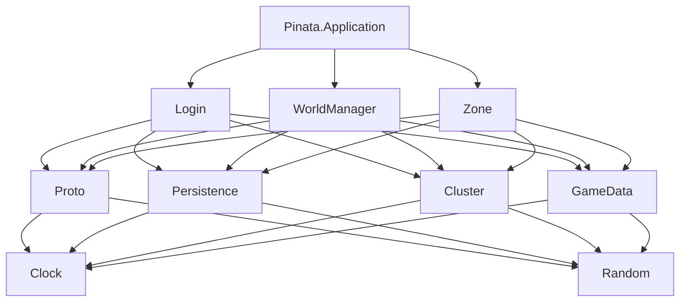
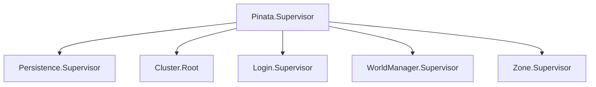

# Technical documentation

How the server is built now. The reasons are in the ADRs (`docs/adr/`), the behaviour of the original server in `docs/protocol/` and `docs/pseudocode/`.

## Parts and boundaries

The server is one Mix project, application `:pinata` ([ADR 0001](../../../docs/adr/0001-single-mix-project-with-checked-boundaries.md)). Each top-level namespace is a boundary, and the `boundary` compiler fails the build on a reference that the table does not allow.

| Boundary | Kind | What | May use |
|---|---|---|---|
| `Login` | part | the Login part | all libraries |
| `WorldManager` | part | the WorldManager part | all libraries |
| `Zone` | part | the Zone part | all libraries |
| `Proto` | library | framing, cipher, packet definitions | `Clock`, `Random` |
| `Persistence` | library | database access | `Settings`, `Clock`, `Random` |
| `Cluster` | library | registry and the facades between parts | `Settings`, `Clock`, `Random` |
| `GameData` | library | client and server data tables | `Clock`, `Random` |
| `Settings` | library | the settings of the node, read once at start-up | nothing |
| `Clock` | library | the only reader of system time | nothing |
| `Random` | library | the only caller of `:rand` | nothing |
| `Pinata.Application` | application | starts the supervision tree | the parts, `Persistence`, `Cluster`, `Settings` |

A part never uses another part. The boundaries are almost empty: the parts have only empty supervisors that the application starts.

ADR 0001 calls the protocol library `Protocol`. Elixir already has a core module of that name, so the module is `Proto`.

The diagram leaves out three sets of arrows that the table has: the parts also use `Clock` and `Random`, and the application uses `Persistence` and `Cluster`. Every part, `Persistence`, `Cluster` and the application also use `Settings`.

## Start-up

`Pinata.Application.start/2` calls `Settings.load(System.get_env())`. On problems it prints them all to standard error and returns `{:error, :invalid_settings}`. Otherwise `Pinata.Supervisor` (`:one_for_one`) starts `Persistence.Supervisor`, `Cluster.Root`, then one supervisor per part in `PINATA_PARTS`, each with the settings as its argument. The part supervisors have no children yet.

## Settings

`Settings` loads the TOML file and the environment, `Settings.Schema` holds the NimbleOptions schema, `Settings.Doc` renders [`docs/user/settings.md`](../user/settings.md) from it. NimbleOptions stops at the first error, so `Settings.Schema.validate/1` walks the schema and sends each leaf through `NimbleOptions.validate/2` alone; that way every problem is reported together. There is no release config provider because a provider runs only in a release and there is none yet; `Toml.decode/1` in `start/2` behaves the same everywhere.

A new key goes into `Settings.Schema` and the type `Settings.t()`. Then regenerate the page: `mix run -e 'File.write!("docs/user/settings.md", Settings.Doc.render())'`. `server/test/settings_doc_test.exs` fails when it is stale.

## Cluster registry

`Cluster.Registry` names the Login process `{:global, {:login}}` and each WorldManager `{:global, {:world_manager, world_id}}`, and keeps one `:pg` group `{:zones, world_id}` of Zone processes per world. The `:pg` scope `Cluster.Registry` is started by `Cluster.Root`. libcluster runs only when `cluster.nodes` is not empty, with `Cluster.Strategy.Epmd` and those hosts. `Cluster.Root` has that name because libcluster owns `Cluster.Supervisor`. Facade modules come with the issues that need them. See [ADR 0002](../../../docs/adr/0002-fail-simple-cluster-model.md).

## Time and randomness

Server code reads time through `Clock` and random numbers through `Random`, never directly ([ADR 0008](../../../docs/adr/0008-byte-compatibility-proven-by-capture-replay.md)). Each forwards to a source module taken from the application environment (`:clock_source`, `:random_source`), so a test can put its own source in place.

## The gate

`mix check` and the three custom Credo checks in `server/credo/checks/` are described in [`server/AGENTS.md`](../../AGENTS.md). Each check has a probe file in `server/test/probes/` that breaks its rule, and a test that requires the check to report it.
