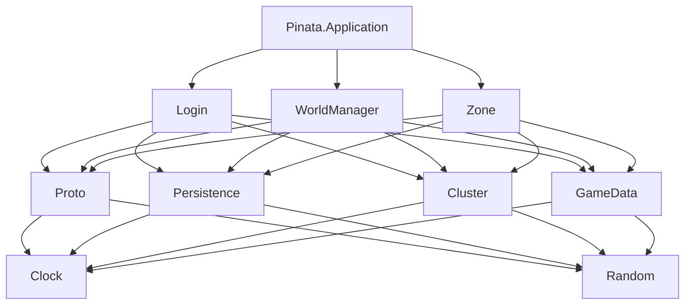

# Technical documentation

How the server is built now. The reasons are in the ADRs (`docs/adr/`), the behaviour of the original server in `docs/protocol/` and `docs/pseudocode/`.

## Parts and boundaries

The server is one Mix project, application `:pinata` ([ADR 0001](../../../docs/adr/0001-single-mix-project-with-checked-boundaries.md)). Each top-level namespace is a boundary, and the `boundary` compiler fails the build on a reference that the table does not allow.

| Boundary | Kind | What | May use |
|---|---|---|---|
| `Login` | part | the Login part | all libraries |
| `WorldManager` | part | the WorldManager part | all libraries |
| `Zone` | part | the Zone part | all libraries |
| `Proto` | library | framing, cipher, packet definitions | `Clock`, `Random` |
| `Persistence` | library | database access | `Clock`, `Random` |
| `Cluster` | library | registry and the facades between parts | `Clock`, `Random` |
| `GameData` | library | client and server data tables | `Clock`, `Random` |
| `Clock` | library | the only reader of system time | nothing |
| `Random` | library | the only caller of `:rand` | nothing |
| `Pinata.Application` | application | starts the supervision tree | the parts, `Persistence`, `Cluster` |

A part never uses another part. `Proto` is built; the other boundaries are empty, and the application starts no part.

ADR 0001 calls the protocol library `Protocol`. Elixir already has a core module of that name, so the module is `Proto`.

The diagram leaves out three sets of arrows that the table has: the parts also use `Clock` and `Random`, and the application uses `Persistence` and `Cluster`.

## Protocol

[`protocol.md`](protocol.md) describes framing, cipher and packet definitions; [`packets.md`](packets.md) lists the defined packets (generated).

## Time and randomness

Server code reads time through `Clock` and random numbers through `Random`, never directly ([ADR 0008](../../../docs/adr/0008-byte-compatibility-proven-by-capture-replay.md)). Each forwards to a source module taken from the application environment (`:clock_source`, `:random_source`), so a test can put its own source in place.

## The gate

`mix check` and the three custom Credo checks in `server/credo/checks/` are described in [`server/AGENTS.md`](../../AGENTS.md). Each check has a probe file in `server/test/probes/` that breaks its rule, and a test that requires the check to report it.
