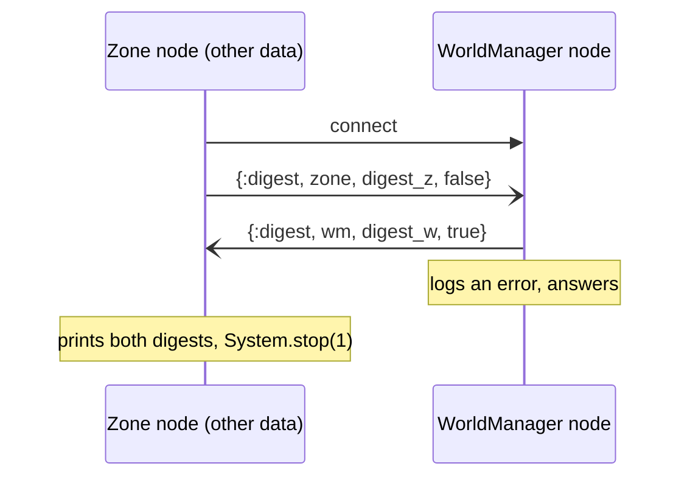

# Cluster

How the parts find each other and call each other (ADR 0002: fail simple).

## Names and groups

| Name | What |
|---|---|
| `{:global, {:login}}` | `Login.Tokens`, the login token process |
| `{:global, {:world_manager, world_id}}` | `WorldManager.World` of a world; its presence means the world is open |
| `:pg` group `{:zones, world_id}` | Zone processes of a world |
| `:pg` group `{:players, world_id}` | WorldManager connections that logged in (`Cluster.Registry.join_players/2`, `player_count/1`) |
| `:pg` group `{:session, user_no}` | the process that is the session of the account |

The `:pg` scope `Cluster.Registry` is started by `Cluster.Root`. libcluster runs only when `cluster.nodes` is not empty, with `Cluster.Strategy.Epmd` and those hosts. `Cluster.Root` has that name because libcluster owns `Cluster.Supervisor`.

## Sessions

`Cluster.Sessions.take_over/1` makes the calling process the session of an account and sends every older member `{:cluster, :session_replaced}`; the connection handlers answer it with `0x0C17 {0x683}` and close. `Cluster.Sessions.leave/1` ends it: Login's connection calls it when it hands the client to WorldManager, so the later WorldManager login does not cut the Login link. A token login (`0x0C37`) calls `take_over/1` too.

## Facades

A part reaches another part only through a facade module of `Cluster` (never a direct call). `Cluster.WorldManager.expect_login/2` is a `GenServer.call` of `{:expect_login, request}` to the `WorldManager.World` of the world; the process answers `:ok` and stores the reservation. It exits when the world is not registered. Flow: [`flows/world-select.md`](flows/world-select.md). `Cluster.Login.create_token/2` is a `GenServer.call` of `{:create_token, user_no, user_name}` to `Login.Tokens`; it returns `{:ok, token}` or `{:error, :pending}` and exits when Login is not registered. Flow: [`flows/return-to-world-list.md`](flows/return-to-world-list.md).

## Node log

`Cluster.NodeLog` (registered under its module name) runs on every node in multi-node mode and is not started in single-node mode; `Cluster.Root` starts it. It monitors node connections (`:net_kernel.monitor_nodes/1`) and logs `Cluster: node <node> connected` (info) on `nodeup` and `Cluster: node <node> lost` (warning) on `nodedown`. The world lines are written by `Login.WorldWatch` (see `processes.md`).

## Data directory digest

`Cluster.DataDigest` (registered under its module name) runs on every node in multi-node mode and is not started in single-node mode (ADR 0006; `Pinata.Application` computes `GameData.digest/1` and passes it with `authority?: true` when the node runs the WorldManager part). It monitors node connections (`:net_kernel.monitor_nodes/1`) and sends the cast `{:digest, node, digest, authority?}` to the process of the same name on every node that is connected when it starts and on every `nodeup`. The receiver decides:

| Receiver | Sender | Equal digests | Different digests |
|---|---|---|---|
| any | any | nothing | |
| no WorldManager part | WorldManager node | | prints both digests to standard error ("Data directory digest mismatch, the node stops:") and calls `System.stop(1)` |
| WorldManager part | no WorldManager part | | logs an error naming the node and both digests, answers with its own digest, so the other node stops even when it missed the first announcement |
| same kind of node | | | nothing: two WorldManager nodes, or two Login or Zone nodes, do not check each other |

Limits: the check is asynchronous, so a node runs unchecked until it sees a WorldManager node; the refused node is not disconnected on the network level (it stops itself); a node that never connects to a WorldManager node is never checked. The check is not a security measure.
