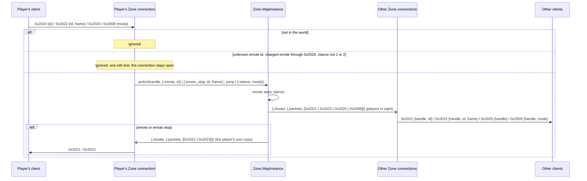

# Flow: emotes, sit, jump and stance

An emote (`0x2020`), an emote stop (`0x2022`), a jump (`0x2024`) or a stance change (`0x2008`) of a player in the world
(`Zone.Handler`, `Zone.MapInstance.action/3`). The map instance of the player relays it to the players in sight and
keeps the emote state that later appear packets show; WorldManager takes no part.

The player's own copy reaches its connection like the answers of a move: the map sends it before it replies, and the
connection sends it before it reads the next frame.

## Who gets what

| Client packet | Server packet | Receivers |
|---|---|---|
| `0x2020 NC_ACT_EMOTICON_CMD {u8 id}` | `0x2021 NC_ACT_SOMEONEEMOTICON_CMD {u16 handle, u8 id}` | players in sight and the player |
| `0x2022 NC_ACT_EMOTICONSTOP_CMD {u8 id, u16 frame}` | `0x2023 NC_ACT_SOMEONEEMOTICONSTOP_CMD {u16 handle, u8 id, u16 frame}` | players in sight and the player |
| `0x2024 NC_ACT_JUMP_CMD {}` | `0x2025 NC_ACT_SOMEEONEJUMP_CMD {u16 handle}` (sic, official name) | players in sight, not the player |
| `0x2008 NC_ACT_CHANGEMODE_REQ {u8 mode}` | `0x2009 NC_ACT_SOMEONECHANGEMODE_CMD {u16 handle, u8 mode}` | players in sight, not the player |

A player in mode 0 (before its map instance ran `login_complete/2`) causes nothing. A running mover is stepped to the
clock's millisecond first and keeps running.

## Checks

`Zone.Handler` checks the client values before it calls the map instance:

- `0x2020`: the id must have an `ActionViewInfo` row (`nIndex`). A row with `eActionType` 2 (charged emote, played
  through an item) is ignored too; types 0 (default) and 1 (emotion) are relayed. Lines: `Zone: emote ignored: unknown
  id <id>`, `Zone: emote ignored: charged emote <id>`.
- `0x2022`: the id must have a row, of any type. Line: `Zone: emote stop ignored: unknown id <id>`.
- `0x2008`: the mode must be 1 (normal) or 2 (combat). Line: `Zone: stance ignored: mode <mode>`.

Each line is `info`; the connection stays open, as the original ignores these packets too. The 2016 `ActionViewInfo`
has 105 rows, no row 21, and the rows 31 to 105 are charged emotes. The four packets before `0x1803` are ignored
without a line.

## Emote state

`Zone.Player.emoticon` is the pair `{emoticon_id, emoticon_frame}` that `Zone.Sight.brief/1` writes into the appear
packet `0x1C06` (and the elements of `0x1C07`):

- `{0xFF, 0}` for a new player (the original's object constructor). The entrant's own `0x1C06` of the entry exchange
  carries it (capture 45 index 235, capture 52 index 492).
- `{0xFF, 0xFFFF}` once cleared ("ClearEmoticon" writes `ShineObject::so_defstopmotion`): after `login_complete/2`
  (the original's `0x1803` handler clears after the exchange), after an accepted walk or run (after the relay), a jump
  and a stance change. Every later appear of a player without an emote has it (capture 45 indices 214, 886, 888).
  `docs/pseudocode/zone/Z02-actions.md` §2 says `{0, 0}`; the binary and the capture win.
- `{id, 0}` after `0x2020`, `{id, frame}` after `0x2022`.

A stop `0x2012`, a refused move and a pull-back leave the emote state as it is.

`Zone.Player.stance` (1 or 2, set by `0x2008`) is the `mode` byte of `0x1C06` once the player is in the world (0
before).

## The sit

The sit is emote 7: the 2016 client sends `0x2020 {7}` for "Sit" and nothing for "Stand"; the stand shows as the next
action that clears the emote state. Nothing in the server treats 7 differently from any other row.

## Not built

The gamble-game refusal of `0x2020`, `CancelOnAction`, the Lua jump triggers (10), the pet dance (9), the tent shape
restore of `0x2008`, charged emotes `0x2067` (9) and the quest hook (5). The `0x2013 {entrant}` the original sends to
the players in sight during `0x1803` (capture 45 index 239) is not sent: its cause is not reconstructed.

## Tests

`test/actions_test.exs` (end to end over real sockets, the bytes of capture 45 and 14), `test/zone/map_instance_test.exs`
(receivers and state), `test/proto/packets/act_test.exs` (codecs). `0x2022` / `0x2023` were never captured; they are
built from Z02 §4 and belong on the manual real-client check.
