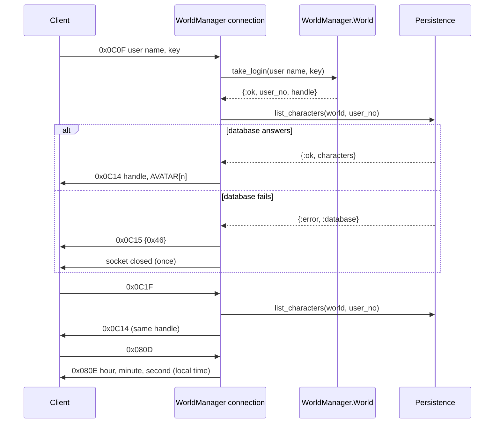

# Flow: character list

From the accepted `0x0C0F` at WorldManager to the list `0x0C14` and the two requests that follow (`WorldManager.Handler`, `WorldManager.World`, `Persistence.list_characters/2`, `WorldManager.Avatar`).

`0x0C1F` and `0x080D` are answered only after the login was accepted; before that they close the socket like any first packet other than `0x0C0F`.

## AVATAR (0x82 bytes)

The same record is sent in `0x1406` after a creation, with two differences: see [`character-create.md`](character-create.md).

| Field | Source |
|---|---|
| `chrregnum` | `characters.id` |
| `name`, `level`, `slot` | `name`, `level`, `slot` |
| `loginmap` | `login_map`, `"RouT"` when `tutorial_state` is 0 (P02-B33) |
| `delinfo` | zero (deleted characters are never listed) |
| `gender`, `chrclass`, `race` | `gender`, `class`, `race` |
| `hairtype`, `haircolor`, `faceshape` | `hair`, `hair_color`, `face` |
| `equip` | 20 `u16`, `0xFFFF` for an empty slot; table below |
| `upgrade_*` | low 4 bits of `upgrade` of slots 10 (left hand), 12 (right hand), 7 (body), 19 (leg), 21 (shoes); 0 when empty; `upgrade_unused` 0xF |
| `kq_handle` | constant `0xFFFFFFFF` |
| `kq_map_name`, `kq_x`, `kq_y` | `kq_map`, `kq_x`, `kq_y` |
| `kq_date` | `kq_date` in local time: year:4 (low bits), month:4, day:5, hour:5, min:6 in 24 bits little-endian; the next byte holds the seconds (low 6 bits) |
| `need_change_id`, `change_id_init`, `change_id_row_no` | 0, `0x64`, 0 |
| `tutorial_state`, `tutorial_step` | `tutorial_state`, `tutorial_step` |

Equipment slot (`items.slot`, storage 8) to index in `equip`:

| Index | 0 | 1 | 2 | 3 | 4 | 5 | 6 | 7 | 8 | 9 | 10 | 11 | 12 | 13 | 14 | 15 | 16 | 17 | 18 | 19 |
|---|---|---|---|---|---|---|---|---|---|---|---|---|---|---|---|---|---|---|---|---|
| Slot | 1 | 24 | 12 | 7 | 10 | 19 | 21 | 22 | 20 | 8 | 27 | 28 | 26 | 11 | 13 | 9 | 17 | 18 | 25 | 29 |

Items in any other slot are not sent.

## Session handle

`worldmanager` is a counter per `WorldManager.World`: 0, 1, 2, ... wrapping at 0xFFFF, taken with the reservation. Nothing looks a session up by it yet (milestone 2). In a replay it goes through the handle map (`:wm_session`).

## Original-server bugs

- P02-B1 (only the first `delinfo` byte is written): fixed, `delinfo` is zero; masked in the replay.
- P02-B7 (two uninitialised bits above the seconds of the Kingdom Quest date): fixed, 0; masked in the replay.
- W05-B10 (a failed list closes twice): fixed, one close.
- P02-B33 (`"RouT"` for a character with `tutorial_state` 0): kept, milestone 2.

## Differences from the original

- No newbie / comeback round trip (`0x0C60` to `0x0C64`), no tutorial-skip flag, no rename rights (`0x0C5F` waits for milestone 2).
- `nKQHandle` is the constant `0xFFFFFFFF`.
- The list is ordered by slot.
- The handle is a counter.
