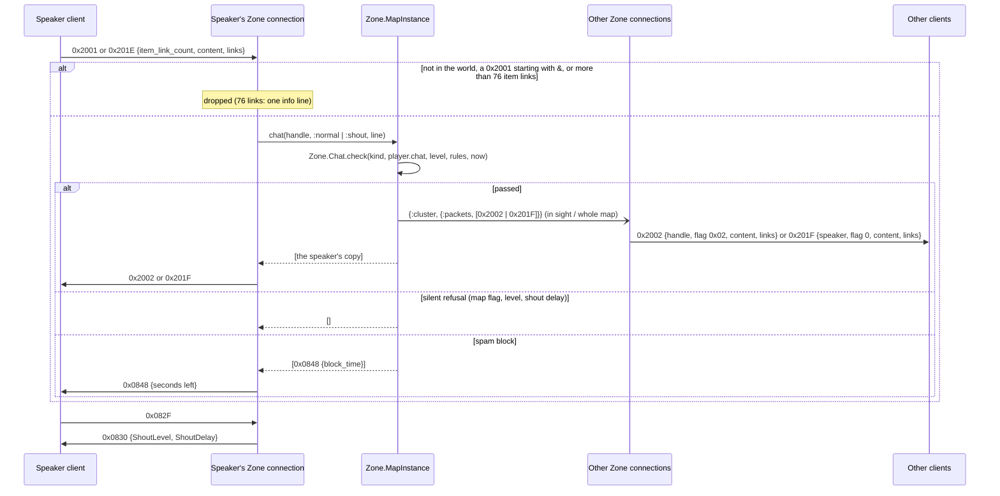

# Flow: normal chat and shout

A line of normal chat (`0x2001`) or a shout (`0x201E`) of a player in the world (`Zone.Handler`,
`Zone.MapInstance.chat/4`, `Zone.Chat`). The map instance of the speaker checks the line and relays it; WorldManager
takes no part.

The speaker's copy comes back in the reply of `chat/4`, so it leaves the speaker's connection before the answer to its
next packet.

## Checks, in order

`0x2001` (normal chat):

1. The connection is in the world (after `0x1803`); before that the packet is ignored.
2. A line starting with `&` is dropped and never shown: it is a GM command (issue 116).
3. At most 76 item links; more are dropped with the line `Zone: chat dropped: <n> item links`.
4. The `Chat` flag of the map's first `FieldList` row (no row: refused).
5. The spam filter.

`0x201E` (shout):

1. The connection is in the world.
2. At most 76 item links; more are dropped with the line `Zone: shout dropped: <n> item links`.
3. The `Shout` flag of the map's first `FieldList` row (no row: refused).
4. The level is above `ShoutLevel` (`ChrCommon`, 5); without `ShoutLevel` or `ShoutDelay` shout is refused everywhere.
5. The last accepted shout attempt is more than `ShoutDelay` seconds (2) ago.
6. The delay starts now, before the spam check: a shout the filter blocks still starts it.
7. The spam filter.

Every refusal is silent, as in the original. 76 is the largest count for which `0x201F` with 255 content bytes stays
under the frame limit (`2 + 23 + 255 + 76 × 103 = 8108 < 0x1FFE`). A packet whose size does not match its length and
item-link count is dropped by the size check of `Net.Connection` (one `debug` line `dropped a packet of the wrong
size`). Item links are relayed as opaque bytes. An empty line is relayed and counted like any other.

Receivers: normal chat goes to the speaker and every player in sight of it (`Zone.Sight.receivers/2`); a shout goes to
every player of the map instance in mode 1, the shouter included, whatever its dimension, sub-layer or distance.

## Spam filter

From `SpamerPenaltyRule.shn` (one row: `RepeatRule` 3, `SecondRule` 3000 ms) and `SpamerPenalty.shn` (one row per
penalty level: `ChatBlockTime`, `ProbateTime` in seconds; 2016: 10/15, 20/30, 30/45, 60/90, 120/180, … 3600/5400).

- The times of the last `RepeatRule` counted lines (normal chat and shout together) are kept. When `RepeatRule` lines
  fall within `SecondRule` ms, the chat of the player is blocked for the block time of its level and the ring is
  emptied; it then stays on probation for the probation time after the block.
- A line while blocked is not counted and gets `0x0848` with the seconds left (at least 1).
- A repeat offence inside the probation time climbs a level: the first level whose summed probation times of the levels
  below it cover the last probation. With the 2016 data consecutive offences give 10 s, 20 s, 30 s, 60 s; the last
  row caps it. After the probation the next offence is level 1 again.
- Without a usable row in either table the filter is off (one `info` line at the start of each Zone node).

Times are milliseconds of `Clock.monotonic_time/1` read in the map instance; the original counts tenths of a second.

## Packets

| Opcode | Direction | Fields |
|---|---|---|
| `0x2001` NC_ACT_CHAT_REQ | client → Zone | `item_link_count: u8`, `content` (u8 length), `links` (`item_link_count × 0x67` opaque bytes) |
| `0x2002` NC_ACT_SOMEONECHAT_CMD | Zone → speaker and players in sight | `item_link_count: u8`, `handle: u16`, `len: u8`, `flag: u8` (0x02: chat window), `font_color: u8` (0), `balloon_color: u8` (0), `content` (`len` bytes), `links` |
| `0x201E` NC_ACT_SHOUT_CMD | client → Zone | as `0x2001` |
| `0x201F` NC_ACT_SOMEONESHOUT_CMD | Zone → every player of the map | `item_link_count: u8`, `speaker: char[20]`, `flag: u8` (0), `content` (u8 length), `links` |
| `0x0848` NC_MISC_CHAT_BLOCK_SPAMER_BLOCKTIME_CMD | Zone → speaker | `block_time: u32` (seconds left) |
| `0x082F` NC_MISC_SERVERPARAMETER_REQ | client → Zone | empty; answered in `:loading` and `:in_world` |
| `0x0830` NC_MISC_SERVERPARAMETER_ACK | Zone → client | `shout_level: u8`, `shout_delay: u16` (seconds); not sent when `ShoutLevel` or `ShoutDelay` is missing (one `debug` line) |

## State

The field `chat` of `Zone.Player`: the times of the spam ring, the end of the block, the end of the probation and the
time of the next shout. It is empty at every entry into a map instance (a map change or a new login forgets a block)
and is never stored. The map instance holds the rules of its map (`Zone.Chat.rules/1`) in its state field `chat`.

## Original-server bugs

- P02-B29 fixed: the bits 2 to 7 of the `0x201F` flag are 0; the original left them as its shared buffer held them
  (masked in replays).
- Z01-B5 kept: the 2016 client has no handler for `0x0830`, so it ignores the answer.
- Z11-B2 (the argument parser of the GM command frame) is not reached: a `&` line is dropped whole until issue 116.

## Absent until their milestones

The GM chat ban and the GM colour bit (7), font and balloon colours (9), the pet keyword (9), Lua chat triggers (10),
the chat-title counter `0x6006` (6), the megaphone `0x204B` (6), party chat (6).
