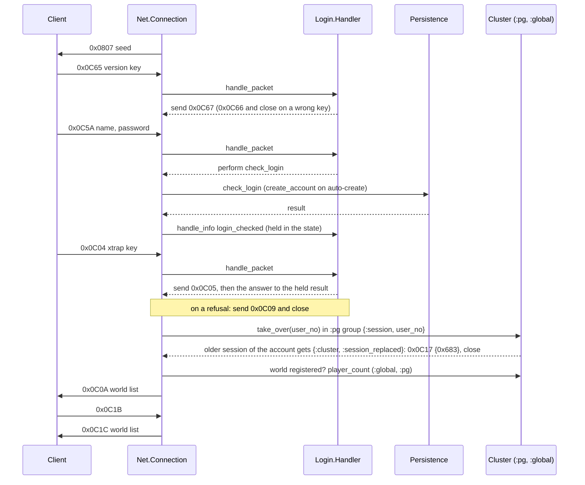

# Flow: login

From the seed to the world list (`Login.Handler`, `Net.Connection`). Selecting a world (`0x0C0B`) is in [`world-select.md`](world-select.md).

## Refusals

The refusal is `0x0C09 {error}`, then the socket is closed.

| Code | Cause | Client text |
|---|---|---|
| 0x45 | unknown name (auto-create off or the name is invalid), wrong password, a database failure (logged; the original answers the same, D01 section 3.2) | Please check ID or Password. |
| 0x47 | account blocked | The ID has been blocked. |
| 0x48 | account not login-able | The World Servers are down for maintenance. |

The password travels from `handle_packet` to `perform` inside `Login.Secret`, whose `inspect` output is `#Login.Secret<...>`.

A wrong `client_version_key` gets `0x0C66` (one byte, 0) and the socket is closed.

## State machine

| Step | Accepts | Else |
|---|---|---|
| `:version` | `0x0C65`: right key to `:login`, wrong key `0x0C66` and close | any other packet closes the socket without an answer |
| `:login` | `0x0C5A` to `:open`; `0x0C37` (token login, [`return-to-world-list.md`](return-to-world-list.md)) to `:open` | any other packet closes the socket without an answer |
| `:open` | `0x0C04`, `0x0C1B` (once logged in) | every other known packet is ignored, `0x0C18` too |

A packet of the wrong size, for example a `0x0C5A` that is not 0x13E bytes long, never reaches the handler: `Net.Connection` drops it and the step stays, as in the original. An opcode without a packet definition closes the socket ([`processes.md`](../processes.md)).

## World name

Each world of `0x0C0A` / `0x0C1C` carries `settings.world` `name`, but the 2016 client does not show it. Its world list draws every row as a cell of the texture `\Account\LoginServerList.nif`, picked by the row's position (`WorldSelectWin::UpdatePageState` @ FUN_00475970), so the first world reads "Enid" whatever the name is. The client uses the name only when the world is selected: it writes `WorldName [ <name> ]` to `%APPDATA%\FiestaOnline\ConnectWorldInfo.txt`. Evidence: `docs/protocol/capture-validation.md` §3.2 (`0x0C0A` row).

## World status

The status byte of a world: 0 when its `WorldManager.World` process is not registered under `{:global, {:world_manager, n}}`; else from the player count (size of the `:pg` group `{:players, world_id}`) against 2500 (`Login.WorldStatus`).

| Players | Status |
|---|---|
| 2375 or more | 5 (full) |
| 750 or more | 10 |
| 250 or more | 9 |
| 200 or more | 8 |
| 125 or more | 7 |
| fewer | 6 |

## Original-server bugs

- L00-B1: `0x0C66` carries a byte the original never writes; we send 0 and the replay masks it.
- L00-B2 (a closed-logins switch refuses with 0x45) does not apply: there is no such switch.
- L00-B5: the key of `0x0C04` is not looked at; kept.
- P02-B22 does not exist: the player count in the world status is real.

## Differences from the original

- `0x0C05` comes before the login answer. The check runs at `0x0C5A`, its result is held and answered right after the `0x0C05` of the next `0x0C04` (every capture has this order). A client that never sends `0x0C04` gets no answer.
- `0x0C1B` is answered only once the account is logged in; the original answers it to anyone past the version check.
