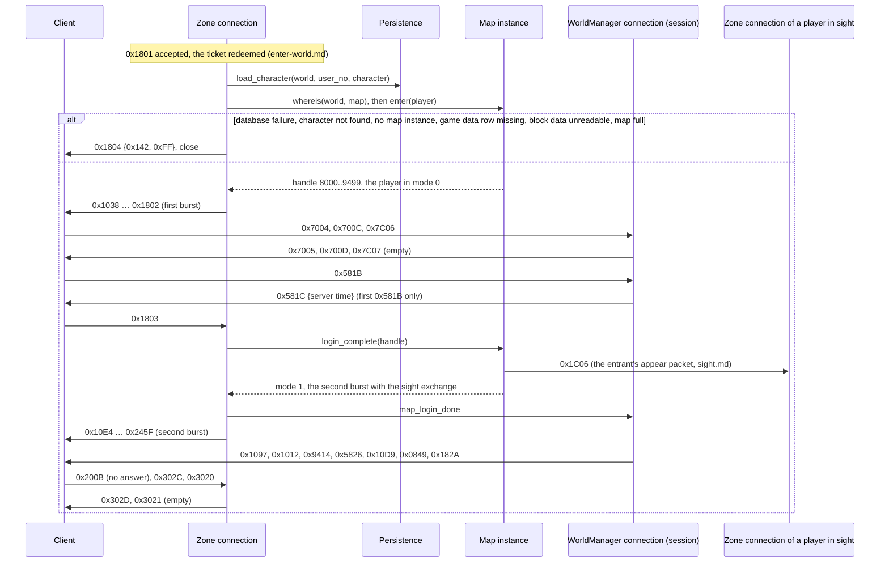

# Flow: map entry

From an accepted `0x1801` at the Zone (see [`enter-world.md`](enter-world.md)) to the WorldManager burst after `0x1803` (`Zone.Handler`, `Persistence.load_character/3`, `Zone.Player`, `Zone.MapInstance`, `Zone.MapEntry`, `Zone.MapEntry.Placeholders`, `Cluster.Sessions.map_login_done/1`, `WorldManager.Handler`, `WorldManager.Placeholders`, `WorldManager.ServerTime`). The burst is the ordered step lists of `Zone.MapEntry` (issue 88): each step is a function from the player to its packets. A step is *real* (data of milestone 2), *empty* (a placeholder: the packet at its original position with the data of a character that has none, tagged with the milestone that owns it), or *absent* (not sent; a comment marks its position). Wire order: `docs/protocol/capture-validation.md` §5.1.

## First burst: `Zone.MapEntry.login/1`

| Step | Packets | Kind | Milestone |
|---|---|---|---|
| `base` | `0x1038`: the stored character, map, position, direction 90, `admin_level`; fame, stat distribution, power and guard stones, LP, PK values, prison minutes and flags are 0 | real | 2 (admin level: issue 116) |
| `shape` | `0x1039` | real | 2 |
| `quest_doing` | `0x103A {id, need_clear 1, 0}` | empty | 5 |
| `quest_done` | `0x103B {id, 0, 12, 0, 0}` | empty | 5 |
| `quest_read` | `0x10CE {id, 0}` | empty | 5 |
| `quest_repeat` | `0x10D7 {id, 0}` | empty | 5 |
| `skills` | `0x103D {0, part_mark 3, 0, id, 0}` | empty | 4 |
| `passives` | `0x103E {0}` | empty | 4 |
| `items` | `0x1047` x4: `{0, box, flag 1}` for boxes 9, 8, 12, 15 | empty | 3 |
| `titles` | `0x1049` all 0 | empty | 6 |
| `charged_buffs` | `0x104A {0}` | empty | 9 |
| `party` | `0x1048 {0xFFFF, 0xFFFF}` | empty | 6 |
| `coins` | `0x10DE {0, 1 000 000}` (a character that never used coins) | empty | 11 |
| `quest_reset_time` | `0x441E` four zeros | empty | 5 |
| `map_login_ack` | `0x1802 {handle, parameter block, x, y}`; the parameter block (`Placeholders.parameters/1`) has the stored HP and SP as maxima and 0 elsewhere | real, parameter block empty | 2, parameters 4 |

## Second burst: `Zone.MapEntry.login_complete/2`

| Step | Packets | Kind | Milestone |
|---|---|---|---|
| `card_collection` | `0x10E4`, `0x10E7`, `0x10EA`, each `{0, 0}` | empty | 11 |
| `equipment_briefs` | `0x1C04` for slots 1 to 29, then per worn item in slot order by `ItemInfo.Class`: 5 → `0x1C05 {handle, item, upgrade, slot, 0xFFFF, 0xFF}`; 6, 7, 8 → `0x1C03`; 10, 26, 37 → `0x1C02`; 4, 38 → nothing; any other class or no `ItemInfo` row → `0x1C04` | real | 2 |
| `kq_team_type` | `0x583A {2}` | empty | 10 |
| sight exchange | `0x1C09` / `0x1C07` batches of the standing NPCs and the players in sight (`Zone.Sight.entry/2`, [`sight.md`](sight.md)); the others in sight get `0x1C06` | real | 2 (mobs: 4) |
| – | abstates `0x242A` / `0x1C18` (345, 291 with its reset after 5 s, 728) | absent | 4 |
| `stat_points` | `0x105B {0}` | empty | 4 |
| `move_speed` | `0x203E {WalkSpeed, RunSpeed}` of `ChrCommon` (33, 127) | real | 2 |
| `booth_size` | `0x9010 {5}` | empty | 6 |
| `can_use_revive_item` | `0x182B {1}` (the default of a field map) | real | 2 |
| `connect_from` | `0x2011 {0, "From <address>"}`, only with an admin level | real | 2 (admin level: issue 116) |
| – | auto-pick `0x10BD` | absent | 9 |
| `minimon_info` | `0x1123 {0, 0, 12 x 0xFFFF, 12 x 0xFFFF}` | empty | 9 |
| – | title abstates `0x1C18` / `0x2429` | absent | 4 |
| `rest_minute` | nothing: `0x0810` belongs to instance dungeons | real | 2 |
| – | prison `0x7C05` | absent | 11 |
| `admin_level` | `0x10C6 {level}`, only when it is not 0 | real | 2 (admin level: issue 116) |
| `item_action_cooltime` | `0x482C {0}` | empty | 4 |
| `mystery_vault` | `0x10D4 {0}` | empty | 11 |
| `field_attribute` | `0x1827 {FieldList.KQ}` | real | 2 |
| `field_type` | nothing: `0x182C` (field type below 3) belongs to instance dungeons | real | 2 |
| `parameter_refresh` | `0x1035` with 26 parameters (flags `0x10, 0x11, 0x24, 0x12` … `0x1B, 0x00` … `0x03, 0x05` … `0x0D`; stored HP for `0x10`, SP for `0x11`, 0 else), then `0x240E {hp, 1}`, `0x240F {sp}`, `0x245F {0}` | empty | 4 |

## WorldManager burst and the login-time requests

| Packet | When | Kind | Milestone |
|---|---|---|---|
| `0x7005 {0, 24 zero bytes}` | `0x7004` | empty | 6 (stored shortcuts: issue 132) |
| `0x700D {0, 392 zero bytes}` | `0x700C` | empty | 6 |
| `0x7C07 {0x0DB1, 0}` | `0x7C06` | empty | 11 |
| `0x581C {Unix time, tm}` | first `0x581B` of the session; later ones get nothing; no Kingdom Quest list `0x581D` | real (list: 10) | 2 |
| `0x1097 {0, 0}` | `0x1803` at the Zone | empty | 8 |
| `0x1012 {0}` | `0x1803` | empty | 8 |
| `0x9414` all 0 but part 3 | `0x1803` | empty | 11 |
| `0x5826 {0}` | `0x1803` | empty | 10 |
| `0x10D9 {0}` | `0x1803` | empty | 11 (the roadmap names no owner) |
| `0x0849 {tm, time zone}` | `0x1803`: local time, whole hours to UTC | real | 2 |
| `0x182A {0}` | `0x1803` | real | 2 |
| `0x302D {0, 0}` | `0x302C` at the Zone | empty | 3 |
| `0x3021 {0x1041, 3, 0}` | `0x3020` at the Zone | empty | 9 |
| nothing | `0x200B` at the Zone | real | 2 |

A map change (issue 112) repeats only `0x5826` and `0x182A`.

## Map instance

The player enters in mode 0: it receives nothing and is shown to nobody. `0x1803` sets mode 1 and runs the sight exchange ([`sight.md`](sight.md)). The handle is the next free one from 8000 to 9499, counting on from the last handle given, wrapping to 8000; 1500 players fill the map. The instance monitors the Zone connection and removes its player when it ends, announcing it with `0x1805` to the players in sight; saving and leaving are in [`leave-world.md`](leave-world.md). See [`processes.md`](../processes.md).

## Codes

| Code | Packet | When | Client text |
|---|---|---|---|
| `0x142` | `0x1804` | the player cannot be placed: database failure, character not found, no map instance, a game data row missing, block data unreadable, map full | not checked |

## Log lines

| Level | Part | Line |
|---|---|---|
| `warning` | Zone | `connection closed: map entry failed: <reason>` (`database failure`, `character not found`, `no map instance`, `a game data row is missing`, `block data unreadable`, `map instance full`) |
| `warning` | Zone | `connection closed: map login complete failed: not on the map` |
| `debug` | Zone, WorldManager | `dropped a known but unbuilt packet 0x<opcode>` (see [`protocol.md`](../protocol.md)) |

A database failure also writes the `error` line of `Persistence`; an unreadable block data file the `error` line of the map instance.

## Original-server bugs

- Z18-B10: the original leaves the slot of `0x1C05` unwritten; we write the slot.
- Z18-B19: `chrregnum` of `0x10E4`, `0x10E7`, `0x10EA` is unwritten in the original; we send 0.
- Z09-B54: the first byte of `0x2011` is unwritten in the original; we send 0.
- P02-B2: the byte of `0x182A` is never written by the original; we send 0.
- P02-B3: the original adds one unwritten byte to `0x302D`; we send 0.
- Z07-B7: the stale `Wizdom` bytes of the parameter block are 0.

All are masked in replays (`Replay.Masks.global/0`).

## Differences from the original

- The parameter refresh (`0x1035`, `0x240E`, `0x240F`, `0x245F`) ends the `0x1803` answer; the original sends it one tick later. The order on the wire is the same; milestone 4 decides about the tick.
- `0x0810` and `0x182C` are never sent: only plain field maps run in milestone 2.
- `0x7005` and `0x700D` carry no stored option block (`bSuccess` 0); the client then uses its defaults.
- `0x1802` carries the stored position unchanged; moving a player off an occupied cell is not built.
- The option pushes `0x7032` to `0x7034` after `0x1003` are not sent (issue 132), nor the Kingdom Quest list `0x581D` (milestone 10).
- The periodic `0x0849` (every full minute) is not sent; only the first-join copy.
- The level check of `0x1803` (level 0 or above 150 disconnects) is not built.
- The answers to `0x7004`, `0x700C` and `0x7C06` come in request order; the original's `0x7C07` came between `0x7005` and `0x700D`.

## Not checked

The three real-client checks of issue 88 (the client passes the loading screen and stands on the map; the empty inventory, skill and quest windows open; the shortcut bar is empty), and the client text of `0x142`.
