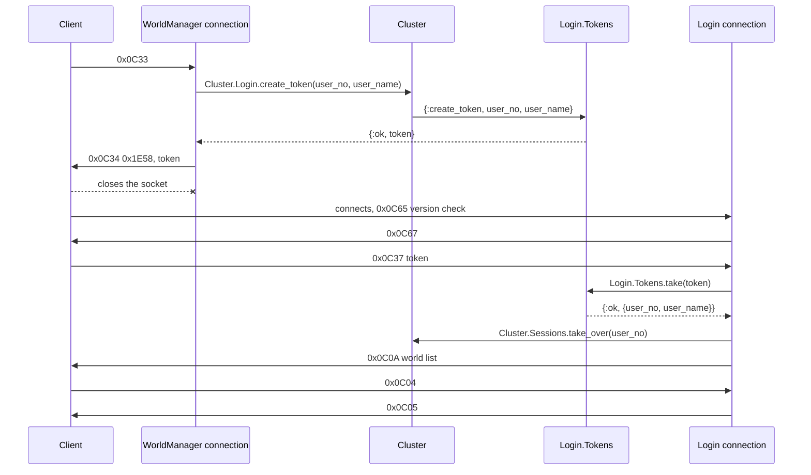

# Flow: return to the world list and quit

From `0x0C33` at WorldManager to the world list at Login again, and `0x0C18` (`WorldManager.Handler`, `Cluster.Login`, `Login.Tokens`, `Login.Handler`).

## The answer `0x0C34`

| Error | Case | Token |
|---|---|---|
| 0x1E58 | token made | 32 lower-case hex characters |
| 0x1E5B | the account has a pending token | 32 zero bytes |

The connection stays open in both cases. The session of the WorldManager connection ends when the client drops the socket (as captured). A `0x0C33` before the `0x0C0F` login closes the socket without an answer, like any other first packet.

## The token

32 hex characters from `Random` (16 bytes), valid for 10 s, good for one use, one pending token per account, in memory in `Login.Tokens` (`{:global, {:login}}`). Every call removes all expired tokens first.

## `0x0C37`

- Valid token: the connection becomes the session of the account (`Cluster.Sessions.take_over/1`; a WorldManager connection of the account that is still open gets `0x0C17 {0x683}` and closes) and the world list `0x0C0A` is sent at once, so it arrives before the `0x0C05` of the following `0x0C04`.
- Unknown, used or expired token: `0x0C09 {0x52}`, then the socket is closed.
- Wrong length: the packet is dropped without an answer and the connection stays in its step, as in the original; the token stays valid.

## Quit and lost connection

`0x0C18 {0}` at WorldManager closes the connection; other types are ignored for now. A closed socket ends the connection process, and with it the session and the player count, once. `0x0C18` at Login is ignored.

## Original-server bugs

- L01-B9 (the sweep skipped the node after a deleted head, so an expired token could still be accepted): fixed, every call removes every expired token.
- L00-B4 (no client text for 0x52): kept by decision.
- W05-B9, W05-B25, P02-B35 are effects on server links and do not exist here; L00-B2 does not apply (as in `login.md`).

## Differences from the original

- The original's `DelByIP` (delete every pending token of the sender's IP on an unknown token) is not copied.
- The token is random hex, not the MD5 text.
- `0x0C18 {0}` closes without a logged-in character; `0x0C18 {1}` does nothing yet.
- Login not reachable: the WorldManager connection crashes (ADR 0002).
