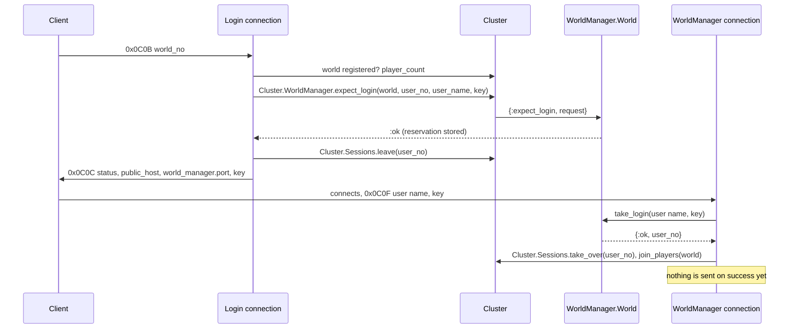

# Flow: world select

From `0x0C0B` at Login to the accepted `0x0C0F` at WorldManager (`Login.Handler`, `Cluster.WorldManager`, `WorldManager.World`, `WorldManager.Handler`).

## The answer `0x0C0C`

| Status | Case | Key | Reservation | Login session |
|---|---|---|---|---|
| 0 | world not registered (or not in the settings) | 32 zero words | none | stays |
| 5 | world full | random | none (L00-B3) | stays |
| 6 to 10 | open | random | made | ends (`leave/1`) |

`ip` is `public_host`, `port` is `world_manager.port` of the Login node. The key is 32 random words. A select before the login answer or by a client that is not logged in is ignored.

## `0x0C0F`

- It must be the first packet; any other first packet closes the socket without an answer. After a successful one every packet is ignored.
- It is accepted when a reservation with the same key and the same user name exists, is unused and is younger than 30 s. The reservation is then deleted. A reservation with the right key and another name is refused and kept.
- Refusal: `0x0C15 {0x44}` (client text "Authentication failed."), then the socket is closed.

## Session

An accepted connection calls `Cluster.Sessions.take_over/1` (an older session gets `{:cluster, :session_replaced}` and answers `0x0C17 {0x683}`) and joins the `:pg` group `{:players, world}`. The way back: [`return-to-world-list.md`](return-to-world-list.md). When the socket closes the process ends and the player count drops.

## Original-server bugs

- W01-B1 (the name was not compared with the reservation): fixed, the name must equal the reservation's.
- L00-B3 (a key without a reservation for a full world): fixed without changing the client bytes.
- P02-B23 (uninitialised key bytes on a refusal): fixed, the key is zero; masked in the replay.

## Differences from the original

- Reservations expire after 30 s.
- The key is 32 random words without the original's check word.
- The Login connection stops being the session at the hand-off.
- A first packet other than `0x0C0F` closes the socket.
- Nothing is sent after a successful `0x0C0F` until the character list issue (`0x0C14`).
