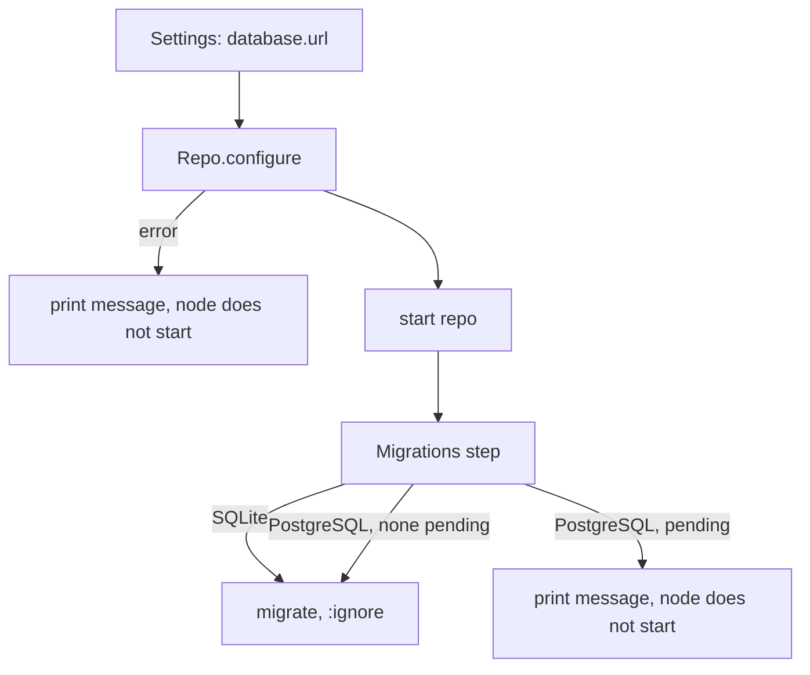

# Persistence

The `Persistence` boundary is the only code that names a repo, a schema or a query ([ADR 0004](../../../docs/adr/0004-one-database-guarded-updates-no-row-locks.md)). Other parts call its functions and read tagged results.

## Modules

| Module | What |
|---|---|
| `Persistence` | the public operations (`create_account/2`, `check_login/2`, `set_blocked/2`, `set_login_able/2`), each one `repo.transact` |
| `Persistence.Supervisor` | starts the repo and the migration step |
| `Persistence.Repo` | private: maps `database.url` to a repo module and its config; `active/0` |
| `Persistence.Repo.Postgres`, `Persistence.Repo.SQLite` | the two Ecto repos |
| `Persistence.Migrations` | private: start-up migration step |
| `Persistence.Account` | private: schema and name rules |
| `Persistence.Password` | private: PBKDF2 hashing |
| `Persistence.Release` | operator commands without Mix; the `mix pinata.*` tasks only call it |

`Persistence.Repo.configure/1` puts the repo config into the application environment, because `Ecto.Migrator.with_repo/3` starts a repo from there, and records the chosen repo as `:persistence_repo`. SQLite runs with `default_transaction_mode: :immediate`.

## Start-up

## The accounts table

| Column | Type | Meaning |
|---|---|---|
| `id` | integer, primary key | the user number |
| `name` | string | as given at creation |
| `name_key` | string, unique | `name` without trailing spaces, ASCII letters lower-cased |
| `password_hash` | binary | PBKDF2-HMAC-SHA256, 32 bytes |
| `password_salt` | binary | 16 bytes from `Random.bytes/1` |
| `password_iterations` | integer | iterations used for this hash |
| `blocked` | boolean | default false |
| `login_able` | boolean | default true |

The name key models SQL Server's default comparison, case-insensitive and blind to trailing spaces of the original (*inferred*). A valid name has 1 to 255 bytes in `0x21..0x7E`; `check_login` never fails on odd bytes, such a name is `:unknown`.

## Passwords

The default is 600,000 iterations; `Application.get_env(:pinata, :password_iterations, 600_000)` lets tests lower it. The compare uses `:crypto.hash_equals/2`. An unknown name still costs one derivation (zero salt) so the time does not tell.

`Persistence` hashes the password bytes it gets. The 2016 client sends 32 lower-case hex characters, the MD5 of the typed password, in `0x0C5A` (`docs/protocol/capture-validation.md` section 16.3), so the account command hashes that form. That the MD5 covers only the typed password is not verified by a capture; the Login part (issue 41) and the capture checkpoint confirm it.

## Login results

`check_login` checks in the original's order (D01 section 3.2): unknown account, wrong password, blocked, not login-able. The Login part will map unknown and wrong password to client code 0x45, blocked to 0x47, not login-able to 0x48.

Fields of D01 section 3.2 not carried over: `bIsDelete`, `nAuthID` / `tUserAuth` (the group flag `bIsLoginAble` became the per-account `login_able`), login by e-mail, timed blocks (`tUserBlock`, `usp_User_chkBlock`), the EGPal and merge additions.

## Tests

`mix test` runs with `--no-start` (alias in `mix.exs`); `test/test_helper.exs` picks the database (`DATABASE_URL`, else a fresh SQLite file in `server/tmp/`) and then starts the application. CI runs the suite on both adapters. `:extra_migration_paths` in the application environment adds migration directories; only a test uses it, to create a pending migration.

## Adding an operation or a migration

An operation is a function in `Persistence` with a `@spec` and one `repo.transact` of guarded statements; follow the portability rules in [`server/AGENTS.md`](../../AGENTS.md). A migration is a new file in `priv/repo/migrations/` with a `change/0`; PostgreSQL nodes refuse to start until `Persistence.Release.migrate()` ran it.
