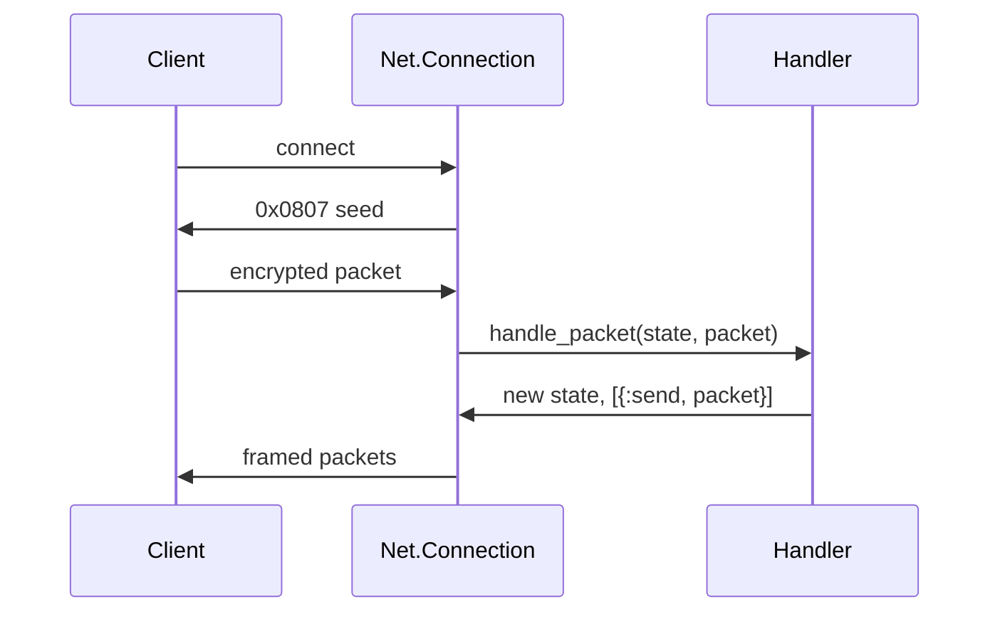

# Processes

## Connection process

One process per client socket ([ADR 0009](../../../docs/adr/0009-one-process-per-map-instance-on-a-fixed-tick.md)). It does framing, cipher, decoding, encoding and send buffering, and nothing of the game.

**Listener.** Each part supervisor starts `Net.Listener` on its port (`login.port`, `world_manager.port`, `zone.port`). It is a Thousand Island listener: Thousand Island compiles on the pinned Erlang and Elixir, so there is no own `:gen_tcp` acceptor pool. Its read timeout is off, because the heartbeat does that job.

**Life of a connection** (`Net.Connection`):

1. `handle_connection/2` draws the seed and sends `0x0807 {seed}` right after accept.
2. `handle_data/3` cuts frames (`Proto.Framing.split/1`), decrypts them (`Proto.Cipher.crypt/2`) and decodes them (`Proto.decode/1`).
3. Heartbeats are answered in the process; every other packet goes to the part handler.
4. The packets the handler returns are encoded and sent (`Proto.encode/1`, `Proto.Framing.frame/1`).
5. The heartbeat and the limits below close the socket.

There is no file in `flows/`: nothing here crosses a part boundary.

**Handler contract.** `Net.Handler` has `init/0` (session state of a new connection) and `handle_packet/2` (state and packet in, new state and effects out; pure). The only effect is `{:send, packet}`. Heartbeat packets never reach the handler. `Login.Handler`, `WorldManager.Handler` and `Zone.Handler` are stubs that ignore every packet.

**Seed.** `Random.uniform(499) - 1` per connection. The original uses a counter per process; the client cannot tell the difference and a per-connection draw needs no shared state.

**Heartbeat.** The process checks once per second against `Clock`. After 30 s without a packet it sends `0x0804`; 180 s after that (210 s without a packet) it closes the socket. Only a successfully decoded packet resets the timer; stray bytes of an unfinished frame do not. `0x0804` and `0x0805` from the client are accepted in every state, so the original's L01-B11 is not copied (`docs/pseudocode/login/L01-process.md`). A test sets a fake clock source and sends the process `:check`.

**What closes a socket.** Never with an error packet.

| Cause | Rule |
|---|---|
| Undecodable frame | `Proto.decode/1` returns an error |
| Oversized frame | long header `00 len_lo len_hi` with `len` above 0x1FFD, closed once the 3 header bytes are in |
| Heartbeat timeout | 210 s without a decoded packet |
| `connection.max_packets_per_second` | more frames than this in a fixed 1 s window; heartbeats count |
| `connection.max_unsent_bytes` | the VM send queue (`send_pend` of `:inet.getstat/1`), read after every send; the listener sets `high_watermark` to twice the limit so a send never blocks before the check |
| Failed send | the socket send returns an error |
