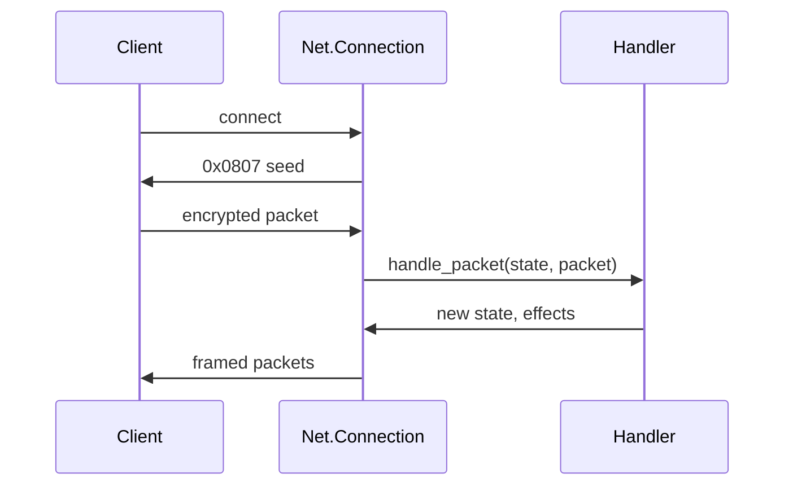

# Processes

## Connection process

One process per client socket ([ADR 0009](../../../docs/adr/0009-one-process-per-map-instance-on-a-fixed-tick.md)). It does framing, cipher, decoding, encoding and send buffering, and nothing of the game.

**Listener.** Each part supervisor starts `Net.Listener` on its port (`login.port`, `world_manager.port`, `zone.port`). It is a Thousand Island listener: Thousand Island compiles on the pinned Erlang and Elixir, so there is no own `:gen_tcp` acceptor pool. Its read timeout is off, because the heartbeat does that job. Its argument is `{part, handler, port, settings}`; `part` is the label of the server log (`"Login"`, `"WorldManager"`, `"Zone"`). Once the socket is bound it logs `<part>: listening on <address>:<port>` (address from `ThousandIsland.listener_info/1`); when the port cannot be bound it prints `<part>: cannot listen on port <port>: <reason>. The node does not start.` to standard error and the start fails.

**Life of a connection** (`Net.Connection`):

1. `handle_connection/2` keeps the part and the peer address (`ip:port`) in its state and as Logger metadata (`part`, `peer`), logs the accept at debug, draws the seed and sends `0x0807 {seed}` right after accept.
2. `handle_data/3` cuts frames (`Proto.Framing.split/1`), decrypts them (`Proto.Cipher.crypt/2`) and decodes them (`Proto.decode/1`).
3. Heartbeats are answered in the process; every other packet goes to the part handler.
4. The effects the handler returns are carried out in order: sends are encoded and sent (`Proto.encode/1`, `Proto.Framing.frame/1`), `{:log, level, message}` writes a server log line, `{:close, level, reason}` ends the connection and writes the close line, `{:perform, request}` is run (below). Every line gets the part and the peer address.
5. The heartbeat and the limits below close the socket.

The login flow is in [`flows/login.md`](flows/login.md).

**Handler contract.** `Net.Handler` has `init/1` (session state of a new connection, from the settings), `handle_packet/2` and `handle_info/2` (state and packet or message in, new state and effects out; both pure) and `perform/1` (impure). The effects are `{:send, packet}`, `{:log, level, message}` (write a server log line), `{:close, level, reason}` (write the close line and close the socket; later effects are not run) and `{:perform, request}`: the connection process calls `perform/1` and hands the result to `handle_info/2`. A message `{:cluster, term}` sent to the connection process goes to `handle_info/2`. A handler does not call `Logger`: it does not know the peer. Heartbeat packets never reach the handler. `Zone.Handler` is a stub that answers nothing.

**Seed.** `Random.uniform(499) - 1` per connection. The original uses a counter per process; the client cannot tell the difference and a per-connection draw needs no shared state.

**Heartbeat.** The process checks once per second against `Clock`. After 30 s without a packet it sends `0x0804`; 180 s after that (210 s without a packet) it closes the socket. Only a successfully decoded packet resets the timer; stray bytes of an unfinished frame do not. `0x0804` and `0x0805` from the client are accepted in every state, so the original's L01-B11 is not copied (`docs/pseudocode/login/L01-process.md`). A test sets a fake clock source and sends the process `:check`.

**A packet of the wrong size** (`Proto.decode/1` returns `:bad_size`: a known opcode with a payload of another length, or a body shorter than an opcode) is dropped and logged at debug level; the connection goes on in the same state. The original drops a `0x0C5A` and a `0x0C37` of the wrong length in the same way. The line carries the part and the peer address. A dropped packet counts for the packet rate and does not reset the heartbeat timer.

**What closes a socket.** Never with an error packet. Every close the server decides on writes exactly one line `<Part>: connection closed: <reason>, peer <peer>` at the level in the table; a close by the client writes one `debug` line (`connection closed by the client`) through `handle_close/2`, and `closed?` in the state tells the two apart.

| Cause | Level, reason | Rule |
|---|---|---|
| Unknown opcode | info, `unknown opcode 0x<op>` | `Proto.decode/1` returns `:unknown_opcode`. The original does the same on all three servers |
| Oversized frame | info, `oversized frame` | long header `00 len_lo len_hi` with `len` above 0x1FFD, closed once the 3 header bytes are in |
| Heartbeat timeout | info, `heartbeat timeout` | 210 s without a decoded packet |
| `connection.max_packets_per_second` | warning, `packet rate exceeded` | more frames than this in a fixed 1 s window; heartbeats count |
| `connection.max_unsent_bytes` | warning, `unsent bytes exceeded` | the VM send queue (`send_pend` of `:inet.getstat/1`), read after every send; the listener sets `high_watermark` to twice the limit so a send never blocks before the check |
| Failed send | warning, `send failed` | the socket send returns an error |
| `{:close, level, reason}` of a handler | its own | wrong first packet, wrong version key, refused login, session replaced, world login refused, character list failed, client logged out (debug) |
| Closed by the client | debug, `connection closed by the client` | not a server decision |

## World process

`WorldManager.World` is one process per world of `settings.world`, started by `WorldManager.Supervisor` and registered under `{:global, {:world_manager, n}}`. Login reads its presence as "the world is open". It also keeps the login reservations Login makes when a client selects the world (`Cluster.WorldManager.expect_login/2`): validate key to user number, user name and time, in memory, each good for one use (`WorldManager.World.take_login/3`) and for 30 s. Flow: [`flows/world-select.md`](flows/world-select.md).

## World watch

`Login.WorldWatch` (registered under its module name) runs in the Login part in multi-node mode only, started by `Login.Supervisor` before the listener. Once a second it looks every world of `settings.world` up in `Cluster.Registry` (the source of the world list) and logs `Login: world <n> (<name>) is available` (info) or `is unavailable` (warning) when a world changes. A world counts as unavailable at start, so nothing is logged until it appears.

## Token process

`Login.Tokens` is the registered process of the Login part (`{:global, {:login}}`), started before the listener. It holds the login tokens WorldManager requests through `Cluster.Login.create_token/2`: 32 hex characters, in memory, good for one use (`Login.Tokens.take/1`) and for 10 s, one pending token per account. Flow: [`flows/return-to-world-list.md`](flows/return-to-world-list.md).
