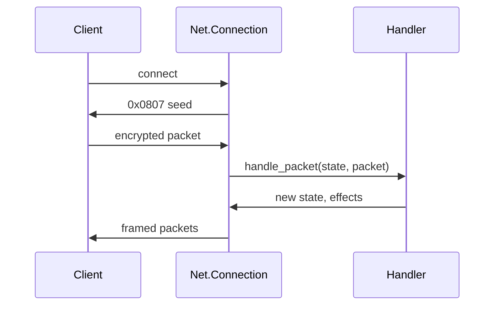
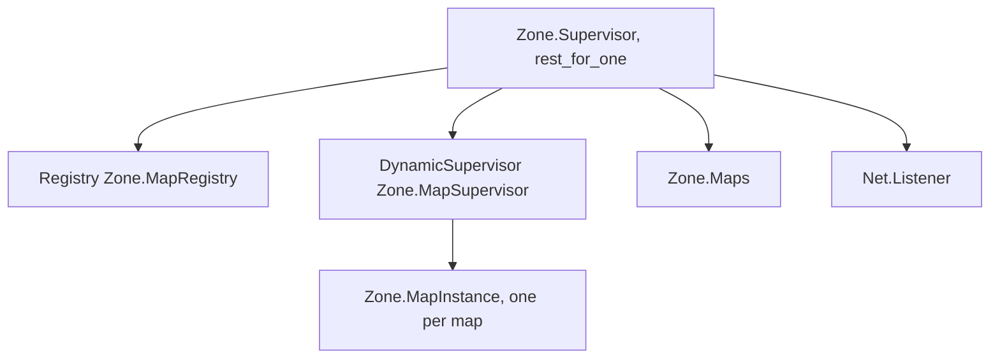

# Processes

## Connection process

One process per client socket ([ADR 0009](../../../docs/adr/0009-one-process-per-map-instance-on-a-fixed-tick.md)). It does framing, cipher, decoding, encoding and send buffering, and nothing of the game.

**Listener.** Each part supervisor starts `Net.Listener` on its port (`login.port`, `world_manager.port`, `zone.port`). It is a Thousand Island listener: Thousand Island compiles on the pinned Erlang and Elixir, so there is no own `:gen_tcp` acceptor pool. Its read timeout is off, because the heartbeat does that job. Its argument is `{part, handler, port, settings}`; `part` is the label of the server log (`"Login"`, `"WorldManager"`, `"Zone"`). Once the socket is bound it logs `<part>: listening on <address>:<port>` (address from `ThousandIsland.listener_info/1`); when the port cannot be bound it prints `<part>: cannot listen on port <port>: <reason>. The node does not start.` to standard error and the start fails.

**Life of a connection** (`Net.Connection`):

1. `handle_connection/2` keeps the part and the peer address (`ip:port`) in its state and as Logger metadata (`part`, `peer`), logs the accept at debug, draws the seed and sends `0x0807 {seed}` right after accept.
2. `handle_data/3` cuts frames (`Proto.Framing.split/1`), decrypts them (`Proto.Cipher.crypt/2`) and decodes them (`Proto.decode/1`).
3. Heartbeats are answered in the process; every other packet goes to the part handler. The handling of each decoded packet, up to its effects handed to the socket, is the telemetry span `[:pinata, :packet]` ([`telemetry.md`](telemetry.md)).
4. The effects the handler returns are carried out in order: sends are encoded and sent (`Proto.encode/1`, `Proto.Framing.frame/1`), `{:log, level, message}` writes a server log line, `{:close, level, reason}` ends the connection and writes the close line, `{:perform, request}` is run (below). Every line gets the part and the peer address.
5. The heartbeat and the limits below close the socket.

The login flow is in [`flows/login.md`](flows/login.md).

**Handler contract.** `Net.Handler` has `init/1` (session state of a new connection, from the settings), `handle_packet/2` and `handle_info/2` (state and packet or message in, new state and effects out; both pure) and `perform/1` (impure). The effects are `{:send, packet}`, `{:log, level, message}` (write a server log line), `{:close, level, reason}` (write the close line and close the socket; later effects are not run) and `{:perform, request}`: the connection process calls `perform/1` and hands the result to `handle_info/2`. A message `{:cluster, term}` sent to the connection process goes to `handle_info/2`. `GenServer.call(connection, {:cluster, request})` goes to the optional `handle_call/2` (state and request in, reply, new state and effects out); the reply is sent after the effects ran, so another connection process can ask a session synchronously (the map-login redeem, [`flows/enter-world.md`](flows/enter-world.md)). A `:DOWN` of a process the handler monitored in `perform/1` goes to `handle_info/2` as `{:down, pid}`. A handler does not call `Logger`: it does not know the peer. Heartbeat packets never reach the handler. `Zone.Handler` handles the map login `0x1801`.

**Monitors between a session and its Zone connection.** From an accepted `0x1801` on, the WorldManager connection (the session) monitors the Zone connection and the Zone connection monitors the session. When the Zone connection ends, the session forgets it and a new `0x1001` works again; when the session ends, the Zone connection closes (`info`, `session ended`). Saving and the leave path are issue 111.

**Seed.** `Random.uniform(499) - 1` per connection. The original uses a counter per process; the client cannot tell the difference and a per-connection draw needs no shared state.

**Heartbeat.** The process checks once per second against `Clock`. After 30 s without a packet it sends `0x0804`; 180 s after that (210 s without a packet) it closes the socket. Only a successfully decoded packet resets the timer; stray bytes of an unfinished frame do not. `0x0804` and `0x0805` from the client are accepted in every state, so the original's L01-B11 is not copied (`docs/pseudocode/login/L01-process.md`). A test sets a fake clock source and sends the process `:check`.

**A packet of the wrong size** (`Proto.decode/1` returns `:bad_size`: a known opcode with a payload of another length, or a body shorter than an opcode) is dropped and logged at debug level; the connection goes on in the same state. The original drops a `0x0C5A` and a `0x0C37` of the wrong length in the same way. The line carries the part and the peer address. A dropped packet counts for the packet rate and does not reset the heartbeat timer.

**A known but unbuilt packet** (`:unknown_opcode` for an opcode that `Proto.Opcodes.client?/2` lists for the part of the connection: a client packet the original Zone or WorldManager registers but that has no packet module yet) is dropped the same way, with one `debug` line `dropped a known but unbuilt packet 0x<op>`; it is no sign of life for the heartbeat either, so a client cannot keep a connection open with it. A Login connection has no such list and closes on every opcode without a module.

**What closes a socket.** Never with an error packet. Every close the server decides on writes exactly one line `<Part>: connection closed: <reason>, peer <peer>` at the level in the table; a close by the client writes one `debug` line (`connection closed by the client`) through `handle_close/2`, and `closed?` in the state tells the two apart.

| Cause | Level, reason | Rule |
|---|---|---|
| Unknown opcode | info, `unknown opcode 0x<op>` | `Proto.decode/1` returns `:unknown_opcode` for an opcode outside the client packets of the part (`Proto.Opcodes`). The original does the same on all three servers |
| Oversized frame | info, `oversized frame` | long header `00 len_lo len_hi` with `len` above 0x1FFD, closed once the 3 header bytes are in |
| Heartbeat timeout | info, `heartbeat timeout` | 210 s without a decoded packet |
| `connection.max_packets_per_second` | warning, `packet rate exceeded` | more frames than this in a fixed 1 s window; heartbeats count |
| `connection.max_unsent_bytes` | warning, `unsent bytes exceeded` | the VM send queue (`send_pend` of `:inet.getstat/1`), read after every send; the listener sets `high_watermark` to twice the limit so a send never blocks before the check |
| Failed send | warning, `send failed` | the socket send returns an error |
| `{:close, level, reason}` of a handler | its own | wrong first packet, wrong version key, refused login, session replaced, world login refused, character list failed, client logged out (debug), Client data check failed (warning), map login refused (info), session ended (info), map entry failed (warning), map login complete failed (warning) |
| Closed by the client | debug, `connection closed by the client` | not a server decision |

## World process

`WorldManager.World` is one process per world of `settings.world`, started by `WorldManager.Supervisor` and registered under `{:global, {:world_manager, n}}`. Login reads its presence as "the world is open". It also keeps the login reservations Login makes when a client selects the world (`Cluster.WorldManager.expect_login/2`): validate key to user number, user name and time, in memory, each good for one use (`WorldManager.World.take_login/3`) and for 30 s. Flow: [`flows/world-select.md`](flows/world-select.md).

The world process also keeps the map table (ADR 0002): `zones` (Zone `pid` to host, port and the maps it offered) and `maps` (map name to the Zone `pid` that runs it). See "Map table" in [`cluster.md`](cluster.md).

## Map instance

`Zone.MapInstance` is one process per map instance (ADR 0009), registered in `Zone.MapRegistry` under `{world number, map name}`; `Zone.MapInstance.whereis/2` looks it up. The map name is `FieldList.map_id_client`, which is also the name of the `.shbd` file and of `ShineNPC.Map`. The state holds `radius`, `npcs`, `npc_index`, `grid`, `block_data`, `players`, `next_handle`, `ticks`, `tick_ref` and `next_tick`.

- **NPCs.** At `init/1` the rows of `ShineNPC` with this map are placed in file order with the handles 17084, 17085, ... (the range 17084 to 17339 of `docs/knowledge/Z01.md` §3) as `Zone.Npc` structs with their prebuilt appear element (`npcs`); `npc_index` holds the shown ones by handle. An NPC without `MobInfo` row keeps its handle, is not shown and is logged (`Zone: map <name>: NPC <mob name> not shown: no MobInfo row`).
- **Sight** ([`sight.md`](sight.md)). `radius` is `MapInfo.Sight` of the map (0 and the line `Zone: map <name>: no MapInfo row, sight radius 0` without a row). `grid` (`Zone.Grid`, cell size = `radius`, 1600 when it is 0) holds the position of every shown NPC and every player. `login_complete/2` runs the entry exchange, `step/3` (the movement of issue 110) sends the appears and disappears of a position change, `set_layer/4` sets dimension and sub-layer of a player and sends nothing, `inform/3` answers `0x1C01`. A player that leaves (`leave/2` or the end of its connection) is announced with `0x1805` to the players in sight through the private `broadcast/3`, the one "to players in sight" function. Packets for another player go to its connection as `{:cluster, {:packets, packets}}`.
- **Block data** is read at the first `enter/2` with `GameData.BlockData.load/2` and logged (`Zone: map <name>: block data loaded, <n> bytes`). When the read fails (file removed or damaged after the start) the entry is refused with `{:error, :no_block_data}`, one `error` line is written and the instance keeps running. It is never unloaded.
- **Players** are `Zone.Player` structs by object handle (`players`). `enter/2` gives the next free handle from 8000 to 9499, counting on from `next_handle` and wrapping from 9499 to 8000, so a freed handle is not reused before the wrap; with 1500 players the entry is refused with `{:error, :full}`. A player enters in mode 0 (receives nothing, shown to nobody); `login_complete/2` sets mode 1, runs the entry exchange and returns the second map-entry burst (`{:error, :not_entered}` for an unknown handle or a player already in mode 1). The instance monitors the connection process of each player and removes its player when it ends, as `leave/2` does. Flow: [`flows/map-entry.md`](flows/map-entry.md).
- **Tick.** Every 100 ms through `Clock.send_after/3`, only while the map has players. The first entry starts the chain; the last `leave/2` ends it by clearing `tick_ref`. Each tick message carries the ref of its chain, so a leave and a new entry inside 100 ms cannot run two chains; a message with another ref is ignored. The schedule is absolute (`next_tick` += 100, the delay is the difference to the clock), so a slow tick does not shift the following ones. A tick only counts (`ticks`); movement comes with issue 110. Each tick is the telemetry span `[:pinata, :tick]` ([`telemetry.md`](telemetry.md)).

## Map supervisor and `Zone.Maps`

`Zone.Supervisor` starts four children in this order and restarts those after a failed child: the registry, `Zone.MapSupervisor`, `Zone.Maps`, the listener. `Zone.Maps` must start again when the map supervisor does, to start the map instances again; the listener is last so the node listens only when its maps run.

`Zone.Maps` (registered under its module name) logs `Zone: <n> of <total> NPC rows skipped: their map does not run` (the `ShineNPC` rows whose map is not a plain field map; 12 of 537 in the 2016 data), then joins the WorldManager of each world of `settings.world` inside `init/1` (`Cluster.WorldManager.join_zone/4` with the names of all plain field maps), so in single-node mode the maps run before the listener starts. It starts the assigned maps under `Zone.MapSupervisor` and logs `Zone: world <n>: <m> map instances started`. When the WorldManager of a world is not registered yet it tries again after 1 s. It monitors the WorldManager: when it is lost it logs a warning and joins again every second until it returns (a map that still runs is kept). A message `{:run_maps, world, names}` from WorldManager (a lost Zone node's maps) starts those maps.

Each map instance sends `Zone.Maps` a `{:watch, ...}` cast at start, and `Zone.Maps` monitors it. A crashed instance (any reason other than `normal` or `shutdown`) is started again by the `DynamicSupervisor` empty and with no block data (it reads it again at the next entry), and `Zone.Maps` writes one `error` line `Zone: map instance <name> of world <n> crashed (<reason>), started again empty`. Disconnecting its players is issue 111.

## World watch

`Login.WorldWatch` (registered under its module name) runs in the Login part in multi-node mode only, started by `Login.Supervisor` before the listener. Once a second it looks every world of `settings.world` up in `Cluster.Registry` (the source of the world list) and logs `Login: world <n> (<name>) is available` (info) or `is unavailable` (warning) when a world changes. A world counts as unavailable at start, so nothing is logged until it appears.

## Token process

`Login.Tokens` is the registered process of the Login part (`{:global, {:login}}`), started before the listener. It holds the login tokens WorldManager requests through `Cluster.Login.create_token/2`: 32 hex characters, in memory, good for one use (`Login.Tokens.take/1`) and for 10 s, one pending token per account. Flow: [`flows/return-to-world-list.md`](flows/return-to-world-list.md).
