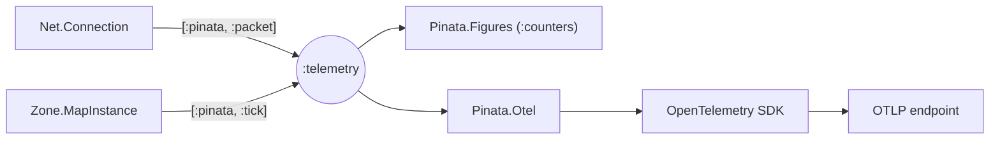

# Telemetry

Server code emits `:telemetry` events and never calls the OpenTelemetry API ([ADR 0011](../../../docs/adr/0011-telemetry-events-in-the-code-opentelemetry-by-a-setting.md)). Two modules listen: `Pinata.Figures` (always) and `Pinata.Otel` (only with `telemetry.otlp_enabled`).

## Events

Both are spans of `:telemetry.span/3`: a `start` event, then a `stop` event (or `exception` when the function raises) with the measurement `duration` in native time units. The metadata of all three events also holds `telemetry_span_context`.

| Event | Metadata | Emitted by | The duration covers |
|---|---|---|---|
| `[:pinata, :packet, :start \| :stop \| :exception]` | `part` (the log label, `"Login"`, `"WorldManager"`, `"Zone"`), `opcode` (last segment of the packet module, `"UserLoginReq"`) | `Net.Connection`, every successfully decoded packet, heartbeats included | from the decoded packet to its effects handed to the socket (sends, log lines, a close); a `perform` effect runs inside it. Dropped packets (wrong size) and unknown opcodes have no span |
| `[:pinata, :tick, :start \| :stop \| :exception]` | `world` (number), `map` (map name) | `Zone.MapInstance`, every tick | the work of the tick message; the wait for the next tick is outside |

## Capacity figures (`Pinata.Figures`)

`Pinata.Application` calls `Pinata.Figures.attach/0` at start-up. It creates one `:counters` array of 15 counters per figure (`:write_concurrency`), converts the bucket bounds to native units once and keeps both in `persistent_term`; then it attaches the handler `"pinata-figures"` to the `stop` and `exception` events of both spans. No process, no ETS table. The handler adds 1 to the bucket of the duration.

- **Bounds** (ms, `boundaries_ms/0`): `0.1, 0.25, 0.5, 1, 2.5, 5, 10, 25, 50, 75, 100, 250, 500, 1000`, plus an overflow bucket. A bound is the inclusive upper bound of its bucket. The duration is compared in native units, not converted (`bucket/1`).
- **Percentile** (`percentile/2`): the bound of the first bucket whose cumulative count reaches `ceil(count * p / 100)`, printed `<= bound`; `> 1000` in the overflow bucket; `-` when nothing was counted.
- **Over nodes:** `collect/0` asks `[node() | Node.list()]` with `:erpc.multicall/5` (5 s) for `snapshot/0`; a node without a good answer is `:error`. `merge/1` sums the good answers element-wise. `print/0` writes `format(collect())`; `reset/0` calls `reset_local/0` on the same nodes.

The administrator's view is in [`operation.md`](../user/operation.md), "Capacity figures".

## OpenTelemetry (`Pinata.Otel`)

`Pinata.Otel` is the only module that names the OpenTelemetry API. `Pinata.Application` calls `Pinata.Otel.start(settings.telemetry)` after `Pinata.Figures.attach/0`.

**Why the SDK starts late.** Inside the SDK an OS environment variable (`OTEL_TRACES_EXPORTER`, `OTEL_METRIC_READERS`, ...) wins over the application environment. So the SDK must not start before the settings are read: `opentelemetry_exporter`, `opentelemetry`, `opentelemetry_experimental` and `opentelemetry_telemetry` are `runtime: false` dependencies in `mix.exs` and are in the release in mode `:load`; `Pinata.Otel.start/1` starts the first three with `Application.ensure_all_started/1` (type `:temporary`, so an SDK crash does not stop the node). The API packages (`opentelemetry_api`, `opentelemetry_api_experimental`) start with the node as usual.

**Start.** `start/1` detaches its handler, stops the SDK applications when they run (only a second start in one VM, the tests, finds them running), sets the level of `tls_certificate_check` to `warning` (its info line `Loading N CA(s) from :otp store` has no part), configures and starts:

| | Export off (`otlp_enabled = false`, default) | Export on |
|---|---|---|
| process environment | `OTEL_TRACES_EXPORTER` and `OTEL_METRIC_READERS` deleted | `OTEL_EXPORTER_OTLP_ENDPOINT` set to `telemetry.otlp_endpoint` when that is set, so the TOML key wins |
| `:opentelemetry` | `traces_exporter: :none` | `traces_exporter: :otlp`, `sampler: {:parent_based, %{root: {:trace_id_ratio_based, trace_ratio}}}` |
| `:opentelemetry_experimental` | `readers: []` | one `:otel_metric_reader`, `export_interval_ms: 60_000`, exporter `:otel_exporter_metrics_otlp` |
| handler, histograms | none | the histograms and the handler `"pinata-otel"` on all six events |
| log line | none | `Pinata: OpenTelemetry export on, trace ratio <ratio>` (the endpoint is not logged: it may hold a secret) |

The protocol is the library default, HTTP/protobuf to `http://localhost:4318`. The other `OTEL_*` variables keep their upstream meaning when export is on (`OTEL_TRACES_SAMPLER` replaces `trace_ratio`). When an SDK application fails to start, `start/1` writes `Pinata: OpenTelemetry did not start (<reason>), nothing is exported` (warning) and the node runs on.

**Spans and metrics.** At `start` the handler opens the span `pinata.packet` or `pinata.tick` through `OpentelemetryTelemetry` with the event metadata as attributes (`part`, `opcode`; `world`, `map`); at `stop` or `exception` it ends it and records the duration in ms in the histogram `pinata.packet.duration` (attribute `part`) or `pinata.tick.duration` (no attribute). The histograms use the bounds of the capacity figures. The span is sampled; the histograms count every event.

**Logs are not exported:** the server log stays on standard output (ADR 0011).

## Tests and CI

`test/pinata/figures_test.exs`, `test/pinata/figures_peers_test.exs` and `test/pinata/otel_test.exs`, and the CI job `otel-smoke` that exports to a real Collector: see [`testing.md`](testing.md).
